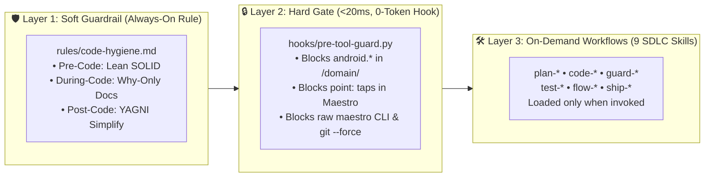
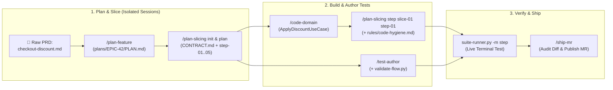
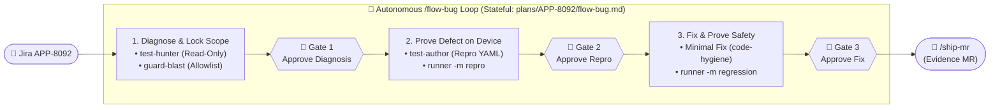
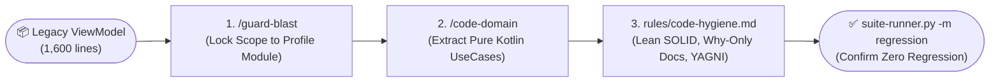

# Android Agentic SDLC (`android-agentic-sdlc`)

> 🌐 **Language:** **English** | [Tiếng Việt (README_VI.md)](./README_VI.md)  
> 📐 **Architecture & Case Studies:** [English (OVERVIEW.md)](./OVERVIEW.md) | [Tiếng Việt (OVERVIEW_VI.md)](./OVERVIEW_VI.md)

> **A production-grade engineering harness for Android & Kotlin teams.**  
> Powered by **9 Specialized SDLC Agent Skills**, **1 Always-On Core Rule (`rules/code-hygiene.md`)**, and **1 Zero-Token PreToolUse Hook (`hooks/hooks.json`)**—built to turn AI coding assistants from unpredictable code generators into disciplined, regression-free mobile engineering partners.

---

## 1. Why `android-agentic-sdlc`? (Mindset & Core Value)

When AI agents are dropped into real-world Android codebases without mobile-specific guardrails, they fail in predictable ways: they jump straight into coding from ambiguous PRDs, generate massive unreviewable PRs, leak `android.*` dependencies into domain logic, accidentally modify adjacent modules, and burn hundreds of thousands of tokens running UI tests.

`android-agentic-sdlc` solves this by replacing ad-hoc prompting with a **deterministic SDLC engineering system**:

| Engineering Bottleneck | ❌ Typical Unconstrained AI Agent | ✅ With `android-agentic-sdlc` |
| :--- | :--- | :--- |
| **Ambiguous Requirements** | Guesses missing edge cases and starts coding immediately, or spawns 5 fragmented planning docs. | **`/plan-feature`** reconciles PRD/Figma into a single `PLAN.md` with Anomaly Triangle stories & ready-to-send Slack questions. |
| **Monolithic PRs & Context Rot** | Plans an entire epic in one session, hallucinating file paths and producing 2,000+ line PRs. | **`/plan-slicing`** enforces **3-Tier JIT Slicing** across isolated `/clear` sessions—capping every step MR at **$\le 300$ lines**. |
| **Tangled Android Architecture** | Mixes `Context`, `SharedPreferences`, and UI state inside 1,500-line ViewModels; forgets Clean Architecture rules mid-chat. | **`/code-domain`** extracts pure Kotlin UseCases, while **`pre-tool-guard.py`** mechanically blocks `import android.*` in `/domain/`. |
| **Trial-and-Error Bug Fixing** | Immediately mutates code based on superficial stack-trace guesses, causing silent regressions elsewhere. | **`/test-hunter`** (strictly read-only) diagnoses root cause first; **`/guard-blast`** locks an explicit **Allowlist** of editable files. |
| **Flaky E2E Tests & Token Bleed** | Writes hardcoded `point: x, y` taps and runs Maestro via raw LLM tool calls, burning 100k+ tokens per suite. | **`/test-author`** enforces semantic selectors; **`suite-runner.py`** streams live ANSI device tests natively at **0 LLM token bleed**. |

### Four Core Engineering Pillars

1. **Context Hygiene via 3-Tier Just-In-Time (JIT) Slicing:** LLMs lose accuracy when forced to hold an entire epic in context. We persist state in lean files (`PLAN.md` & `CONTRACT.md`) and intentionally wipe session memory (`/clear`) between **Lead Contract Init $\to$ Slice Outline $\to$ Step Implementation**.
2. **Zero-Token-Bleed Native Execution:** Never spend LLM tokens on deterministic work. Static validation, lifecycle guardrails (`<20ms`), and high-volume Maestro test orchestration (~270 flows) run in native Python scripts outside the LLM token loop.
3. **Diagnosis Before Mutation & Blast Radius Containment:** Investigation and modification are strictly separated. An agent cannot touch a line of production code until root cause is proven (`test-hunter`) and an editable file allowlist is locked (`guard-blast`).
4. **Human-in-the-Loop at High-Leverage Gates:** Instead of fatiguing developers with constant micro-prompts—or running blindly to completion—workflows pause at **3 high-leverage decision gates** (*Approve Diagnosis $\to$ Approve Reproduction $\to$ Approve Fix*).

---

## 2. System Architecture: The 3-Layer Agentic Defense

Rather than stuffing every instruction into bloated prompts, this repository separates concerns by **how strictly and how often** a behavior must be enforced:



### 🛡️ Layer 1: Always-On Core Rule (`rules/code-hygiene.md`) — *Soft Invariant*
Code quality is an invariant, not an optional slash command. Loaded automatically across every coding task with **zero tool-call overhead**:
- **Pre-Code (Lean SOLID):** Prevents speculative abstractions and single-implementation interfaces.
- **During-Code (Why-Only Docs):** Bans syntax-level comment noise; requires fact-checked causal claims.
- **Post-Code (YAGNI Simplify):** Enforces guard clauses (early returns), removes debug logs (`Log.d`), and forbids test-only `public` APIs.

### 🔒 Layer 2: PreToolUse Lifecycle Hook (`hooks/hooks.json` & `pre-tool-guard.py`) — *Hard Mechanical Gate*
LLMs can forget instructions when context grows; Python scripts do not. Executes in **<20ms** at **0 token cost** before `write_file`, `edit_file`, or `run_command` to mechanically block slips:
- **`[domain-purity-guard]`:** Denies any file write/edit inside `/domain/` that introduces `import android.*` or `import androidx.*`.
- **`[maestro-static-gate]`:** Denies `.maestro/**/*.yaml` writes/edits that violate `ac-NN-<slug>.yaml` naming, use hardcoded coordinate taps (`point: x, y`), or omit assertions.
- **`[command-safety-guard]`:** Denies raw `maestro test` CLI invocations (enforcing `suite-runner.py` to prevent context bleed) and forces explicit user confirmation (`force_ask`) on destructive Git/ADB commands (`git reset --hard`, `git push --force`, `adb uninstall`).
- **`[multi-device-guard]`:** Denies un-isolated `./gradlew ... install...` executions (<20ms) when $\ge 2$ emulators/devices are active without `ANDROID_SERIAL`, preventing cross-deployment collisions between parallel agents.

### 🛠️ Layer 3: 9 Specialized Agent Skills (`skills/`) — *On-Demand Workflows*

| Skill | Directory | Triggers / CLI Command | SDLC Phase | Core Role |
| :--- | :--- | :--- | :--- | :--- |
| **`plan-feature`** | `skills/plan-feature` | `/plan-feature <PRD/Brief>` | Plan | Consolidates ambiguous PRDs/Figma into a unified, lean `plans/<EPIC>/PLAN.md`. |
| **`plan-slicing`** | `skills/plan-slicing` | `/plan-slicing init\|plan\|step` | Plan | Deconstructs Epics into parallel, mockable vertical slices ($\le 300$ lines/MR) via `CONTRACT.md`. |
| **`code-domain`** | `skills/code-domain` | `/code-domain <file>` | Code (Domain) | Extracts pure Kotlin business logic into UseCases/Entities with zero Android framework dependencies. |
| **`test-hunter`** | `skills/test-hunter` | `/test-hunter <ticket\|log>` | Test (Diagnosis) | Strictly read-only root cause investigator. Produces diagnostic reports without modifying code. |
| **`guard-blast`** | `skills/guard-blast` | `/guard-blast <target>` | Guard (Safety) | Computes Blast Radius, locks down an Allowlist of editable files, and derives targeted Regression Matrices. |
| **`test-author`** | `skills/test-author` | `/test-author <target>` | Test (Authoring) | Authors deterministic, semantic Maestro YAML test flows validated by `validate-flow.py`. |
| **`test-runner`** | `skills/test-runner` | `/test-runner <target> [-m ...]` or CLI | Test (Execution) | High-volume test runner with live ANSI terminal streaming, failure snapshots, and 0-token-bleed presets. |
| **`flow-bug`** | `skills/flow-bug` | `/flow-bug <TICKET>` | Flow (Orchestration) | Complete bug lifecycle orchestrator (Understand $\to$ Fix $\to$ Prove $\to$ Ship) with 3 human review gates. |
| **`ship-mr`** | `skills/ship-mr` | `/ship-mr` | Ship (Delivery) | Audits git diffs against test evidence & verified claims; drafts conventional commits and MR bodies. |

---

## 3. Real-World Synergy: How the Ecosystem Works Together

While each skill solves a specific bottleneck, their real value emerges when chained into end-to-end pipelines.

### Pipeline 1: Feature Development (Raw PRD $\to$ Production MR)

**Scenario:** Building an automated promotional discount feature (`EPIC-42: Customer Checkout Voucher Discount`).



**Step-by-Step Walkthrough:**
1. **Consolidate Requirements:**
   ```bash
   /plan-feature docs/prds/checkout-discount.md
   ```
   *Result:* Agent analyzes Figma links and PRD, producing `plans/EPIC-42/PLAN.md` with 3 User Stories and self-contained Slack clarification snippets.

2. **Establish Contracts & Progressive Vertical Slices (Across Fresh Sessions):**
   ```bash
   # Session 1 (Lead): Freeze Contract & Slices Overview table, then /clear
   /plan-slicing init EPIC-42

   # Session 2 (Dev assigned to slice-01): Plan step outline (step-01..step-05) for slice-01 only, then /clear
   /plan-slicing plan slice-01
   ```
   *Result:* Creates `plans/EPIC-42/CONTRACT.md` specifying interface `VoucherRepository` and data class `DiscountResult`, then outlines `step-01..step-05` ($\le 250$ lines each) for `slice-01` inside `plans/EPIC-42/PLAN.md §4` without hallucinating details for other slices.

3. **Extract Pure Domain & Build One Step Per Fresh Session (Under `rules/code-hygiene.md`):**
   ```bash
   # Session 3 (Dev building step-01): Scan code for step-01, micro-plan, extract domain & implement step-01
   /code-domain app/src/main/java/com/app/discount/LegacyDiscountHelper.kt
   /plan-slicing step slice-01 step-01
   ```
   *Result:* `code-domain` creates pure `CalculateVoucherDiscountUseCase.kt` and `DiscountError.kt` with zero Android dependencies. `rules/code-hygiene.md` automatically enforces Lean SOLID, Why-only comments, and YAGNI simplification.

4. **Author & Validate Device Tests:**
   ```bash
   /test-author plans/EPIC-42/PLAN.md --domain 04-discount
   python3 skills/test-author/scripts/validate-flow.py .maestro/EPIC-42/04-discount/
   ```
   *Result:* A deterministic Maestro test flow is generated and statically validated at `.maestro/EPIC-42/04-discount/ac-01-apply-valid-voucher.yaml`.

5. **Verify on Device & Ship:**
   ```bash
   python3 skills/test-runner/scripts/suite-runner.py .maestro/EPIC-42/04-discount/ -m step
   /ship-mr
   ```
   *Result:* A separate terminal window opens, streaming live test execution on the emulator. Once all steps pass, `/ship-mr` audits the diff, verifies test logs, and formats a clean MR ready for code review.

---

### Pipeline 2: High-Confidence Bug Resolution (Jira $\to$ Verified Fix)

**Scenario:** Customer bug `APP-8092: App crashes with NullPointerException when checking out with an empty cart`.



---

### Pipeline 3: Legacy Modernization & Clean Architecture Extraction

**Scenario:** Refactoring a 1,600-line `UserProfileViewModel.kt` that directly reads `SharedPreferences` and makes network calls inside UI handlers.



---

## 4. Prerequisites & Installation Guide

### 4.1. Environment Prerequisites
- **Operating System:** macOS (recommended for live streaming AppleScript terminal) or Linux.
- **Runtimes:** Python 3.9+, JDK 17+, Android SDK.
- **Required CLIs:**
  - `adb` configured in your system PATH (`adb devices`).
  - [Maestro CLI](https://maestro.mobile.dev/) installed (`curl -fsSL "https://get.maestro.mobile.dev" | bash`).
- **Physical Device or Emulator:** An active Android device with USB debugging enabled.

### 4.2. Quick Installation (`install.sh` — Antigravity, Gemini CLI & Claude Code)

Clone this repository once on your machine, then use [`install.sh`](./install.sh) to symlink (or `--copy`) all 9 skills, the always-on rule, and the PreToolUse hook into your Android project or global configuration:

```bash
git clone https://github.com/yukido0205/android-agentic-sdlc.git
cd android-agentic-sdlc
chmod +x install.sh
```

#### Option A: Install into a Specific Android Project (Workspace Scope — Recommended for Teams)
```bash
# Install for both Antigravity/Gemini CLI (.agents/) and Claude Code (.claude/)
./install.sh --project /path/to/your-android-app --target all

# Or install only for Antigravity & Gemini CLI (.agents/)
./install.sh --project /path/to/your-android-app --target agy

# Or install only for Claude Code (.claude/)
./install.sh --project /path/to/your-android-app --target claude

# Note: Add `--copy` if you want to commit the files directly into your Android repo instead of symlinking
./install.sh --project /path/to/your-android-app --target agy --copy
```

#### Option B: Install Globally Across All Projects on Your Machine
```bash
# Install globally into ~/.gemini/config/ (Antigravity & Gemini CLI) and ~/.claude/ (Claude Code)
./install.sh --global --target all
```

### 4.3. Manual Installation Reference (Directory Layout)
If you prefer manual setup without `install.sh`, place or symlink the folders as follows:

| Target Platform | Workspace Path (Per-Project) | Global Path (Machine-Wide) |
| :--- | :--- | :--- |
| **Antigravity & Gemini CLI** | `<android-repo>/.agents/skills/*`<br>`<android-repo>/.agents/rules/code-hygiene.md`<br>`<android-repo>/.agents/hooks.json`<br>`<android-repo>/.agents/hooks/scripts/pre-tool-guard.py` | `~/.gemini/config/skills/*`<br>`~/.gemini/config/rules/code-hygiene.md`<br>`~/.gemini/config/hooks.json`<br>`~/.gemini/config/hooks/scripts/pre-tool-guard.py` |
| **Claude Code** | `<android-repo>/.claude/skills/*`<br>`<android-repo>/.claude/rules/code-hygiene.md`<br>`<android-repo>/.claude/hooks/scripts/pre-tool-guard.py` | `~/.claude/skills/*`<br>`~/.claude/rules/code-hygiene.md`<br>`~/.claude/hooks/scripts/pre-tool-guard.py` |

---

## 5. Detailed Command Reference (The 9 Core Skills)

Below are the exact triggers, syntax, arguments, inputs, and outputs for all 9 skills:

### 5.1. `plan-feature` — Lean Requirements & User Stories
- **When to Use:** When starting a new feature from a raw PRD, Figma link, Jira epic, or vague request.
- **Trigger / Command:**
  ```bash
  /plan-feature docs/prds/checkout-discount-prd.md
  # or
  /plan-feature "Build a biometric login option for users"
  ```
- **Inputs:** Raw requirement text, PRD markdown file, or user prompt.
- **Outputs:** Creates or updates `plans/<EPIC>/PLAN.md` containing reconciled requirements, self-contained open questions (with persona-aware Slack snippets), Anomaly Triangle User Stories, and technical risks.

---

### 5.2. `plan-slicing` — 3-Tier JIT Contract & Ladder Decomposition
- **When to Use:** When breaking down an epic's User Stories into parallel, reviewable slices ($\le 300$ lines) without causing AI hallucination from scanning the entire epic at once.
- **Trigger / Commands (3 Isolated Session Tiers — Persist in Files, `/clear` Between Tiers):**
  ```bash
  # Tier 1 (Lead Session): Freeze Contract & list high-level Slices Overview (NOT PLANNED), then /clear
  /plan-slicing init ORDER-DISCOUNT

  # Tier 2 (Slice Owner's Fresh Session): Cut ONLY your assigned slice (e.g. slice-01) into a step outline (step-01..step-05), then /clear
  /plan-slicing plan slice-01

  # Tier 3 (1 Fresh Session Per Step): Scan code for step-01 only, micro-plan tasks, code, verify & ship MR, then /clear
  /plan-slicing step slice-01 step-01
  ```
- **Inputs:** `plans/<EPIC>/PLAN.md`.
- **Outputs:** `plans/<EPIC>/CONTRACT.md` (mock interfaces, DTOs) and inline step execution ladders inside `plans/<EPIC>/PLAN.md §4` (Lean 2-File Architecture).

---

### 5.3. `code-domain` — Pure Domain Logic Extraction
- **When to Use:** When refactoring business logic out of fat ViewModels, Activities, or legacy helpers into pure Kotlin Clean Architecture.
- **Trigger / Command:**
  ```bash
  /code-domain app/src/main/java/com/app/user/UserViewModel.kt
  ```
- **Inputs:** Target Kotlin source file containing tangled logic and Android framework calls.
- **Outputs:**
  - Evaluates complexity (recommends skipping extraction if trivial CRUD).
  - Generates living domain specification: `docs/domain/<feature_name>.md` and pauses at an Approval Gate.
  - Creates pure Kotlin UseCases (`ApplyDiscountUseCase.kt`), Entities, and Sealed Errors with zero `android.*` imports.

---

### 5.4. `test-hunter` — Read-Only Defect Diagnosis
- **When to Use:** When analyzing a Jira defect, crash log, or user bug report without modifying code.
- **Trigger / Command:**
  ```bash
  /test-hunter "APP-8092: ANR occurs when user submits checkout with zero quantity items"
  # or
  /test-hunter crash-logs/anr-trace.txt
  ```
- **Inputs:** Bug description, stack trace, or logcat output.
- **Outputs:** A structured `DIAGNOSIS` report containing root cause failure mechanism, exact trigger conditions, and list of affected source files. **(Modifies zero code files).**

---

### 5.5. `guard-blast` — Blast Radius & Regression Matrix
- **When to Use:** Post-diagnosis in bug fixing, or when PRD/Figma requirements change mid-sprint.
- **Trigger / Commands:**
  ```bash
  # Mode 1: Mid-flight PRD/design delta
  /guard-blast spec docs/prds/v1.md docs/prds/v2.md

  # Mode 2: Bug fix blast radius & allowlist definition
  /guard-blast plans/APP-8092/flow-bug.md
  ```
- **Inputs:** Diagnosis from `test-hunter` or diff between PRD documents.
- **Outputs:** Strict Allowlist of editable files and a prioritized 3-Tier Regression Test Matrix (`plans/<TICKET>/regression-plan.md`).

---

### 5.6. `test-author` — Maestro YAML Flow Author & Static Validator
- **When to Use:** To author robust, deterministic Maestro UI flows from User Stories or reproduction steps.
- **Trigger / Command:**
  ```bash
  # Step 1: Extract ACs from PLAN.md or flow-bug.md and author Maestro YAML flows
  /test-author plans/APP-8092/flow-bug.md --domain 02-checkout

  # Step 2: Statically validate authored flows (no coordinate taps, assertions present)
  python3 skills/test-author/scripts/validate-flow.py .maestro/APP-8092/
  ```
- **Inputs:** Acceptance criteria, bug reproduction steps, or `PLAN.md` / `flow-bug.md`.
- **Outputs:** Validated Maestro YAML test flow (e.g., `.maestro/APP-8092/02-checkout/ac-01-repro.yaml`) utilizing accessibility ID/text selectors.

---

### 5.7. `test-runner` — Device Test Execution Engine
- **When to Use:** To run single tests, reproduction flows, Figma design checks, or full regression test suites on an emulator or physical device.
- **Invocation Method 1: Inside Agent Chat Window (Slash Command & Natural Language):**
  - **Slash Command:**
    ```text
    # Run a single vertical slice step in streaming terminal
    /test-runner .maestro/02-checkout/ -m step

    # Fast in-process bug reproduction run (15s timeout)
    /test-runner plans/APP-8092/flow-bug.md -m repro

    # Full regression suite run with streaming ANSI monitor
    /test-runner plans/APP-8092/flow-bug.md -m regression

    # Smoke tests in headless mode (suppresses external terminal, outputs in chat)
    /test-runner .maestro/ -m smoke --headless
    ```
  - **Natural Language Prompts:**
    - `"run regression"` or `"verify on device"` $\to$ runs regression mode
    - `"test APP-8092"` or `"verify step-03"` $\to$ runs step mode
    - `"repro bug APP-8092"` $\to$ runs repro mode
    - `"run smoke tests"` $\to$ runs smoke mode
- **Invocation Method 2: Direct CLI Execution (Terminal / Shell / CI):**
  ```bash
  # Mode 'repro': Fast in-process run for bug reproduction
  python3 skills/test-runner/scripts/suite-runner.py plans/APP-8092/flow-bug.md -m repro

  # Mode 'step': Runs a vertical slice step in an external streaming terminal
  python3 skills/test-runner/scripts/suite-runner.py .maestro/02-checkout/ -m step

  # Mode 'regression': Runs full test suite with state reset, streaming ANSI updates, and resume capability
  python3 skills/test-runner/scripts/suite-runner.py plans/APP-8092/flow-bug.md -m regression

  # Mode 'smoke': Fast smoke-tagged check for pull requests
  python3 skills/test-runner/scripts/suite-runner.py .maestro/ -m smoke

  # Headless Flag: Suppresses external terminal (ideal for CI/CD or background runs)
  python3 skills/test-runner/scripts/suite-runner.py .maestro/ -m regression --headless

  # Decoupled Build & Install for Parallel Agents (Mutex Lock Device Isolation)
  # Step 1: Compile APK (zero emulator contact)
  ./gradlew assembleDebug

  # Step 2: Auto-lease available emulator, install APK isolated via ANDROID_SERIAL, and run tests
  python3 skills/test-runner/scripts/suite-runner.py .maestro/02-checkout/ -m step --install
  ```
- **Inputs:** Test directory path, test YAML file, or markdown state file containing a test matrix.
- **Outputs:** Live ANSI streaming terminal, `progress.log`, failure screenshots (`issues/`), and token usage summary.

---

### 5.8. `flow-bug` — End-to-End Bug Lifecycle Orchestrator
- **When to Use:** For single-command, complete resolution of a Jira bug (Diagnose $\to$ Fix $\to$ Prove $\to$ Ship).
- **Trigger / Commands:**
  ```bash
  # Start bug resolution
  /flow-bug APP-8092

  # Resume an interrupted session
  /flow-bug resume APP-8092
  ```
- **Inputs:** Jira ticket ID or defect title.
- **Outputs:** Stateful tracking file `plans/<TICKET>/flow-bug.md`, verified code fix, and ready-to-merge branch.

---

### 5.9. `ship-mr` — Diff Auditing & Review Description Author
- **When to Use:** After implementation and verification, to audit git diff and generate conventional commit and MR body.
- **Trigger / Command:**
  ```bash
  /ship-mr
  ```
- **Inputs:** Staged git diff and test output logs.
- **Outputs:** Formal conventional commit message and Markdown-formatted Merge Request body with embedded test evidence.

---

## 6. Parallel Agent Isolation: Running 2 Agents on 1 Mac with 2 Emulators

When running 2 autonomous AI Agents concurrently on a single Mac (e.g. Agent A fixing bug `PAY-101` on `emulator-5554`, Agent B delivering feature `PROJ-202` on `emulator-5556`), standard tools fail in three fatal ways:
1. **APK Cross-Deployment Collision:** Default `./gradlew installDebug` targets **all running emulators simultaneously**, corrupting test environments across parallel agents.
2. **Mac RAM Exhaustion (OOM Freezes):** If both agents invoke Gradle with default worker counts (CPU core count $\times 2 = 20+$ workers), macOS memory is rapidly exhausted, freezing the machine.
3. **Missing Gitignored Configs in Worktrees:** Standard `git worktree add` only checks out tracked files, leaving out vital Android files (`local.properties`, `keystore.properties`, `google-services.json`, `.agents/`, `.claude/`), breaking Gradle builds and stripping agent skills.

`android-agentic-sdlc` provides a comprehensive **0-Token Isolation Trinity**:

### 🛡️ 1. Zero-Token Android Worktree Initializer (`scripts/init-worktree.sh` — <0.2s)
Generates an isolated workspace per ticket with zero LLM tokens:
```bash
./scripts/init-worktree.sh PAY-101
# or with a custom branch:
./scripts/init-worktree.sh PAY-101 -b feature/pay-checkout
```
- **Automatic Setup:** Creates `.worktrees/<TICKET>` and appends `.worktrees/` to root `.gitignore`.
- **Automatic Symlinks for Vital Android & Agent Files:**
  - `local.properties` (contains required Android SDK path `sdk.dir`).
  - `keystore.properties`, `secrets.properties` (signing configurations).
  - `google-services.json` (at root and across all submodules).
  - `.agents/` and `.claude/` (replicates all 9 Skills, Rules, and Pre-tool Guard hooks into the worktree).
- **RAM Protection:** Injects `org.gradle.workers.max=2` into `.worktrees/<TICKET>/gradle.properties` to ensure concurrent Gradle daemons remain lean without exhausting system memory.

### 🔒 2. Decoupled Build & Install via Mutex Device Lock (`suite-runner.py --install`)
Eliminates untargeted installation commands:
- **Build Phase (No device touch):** `./gradlew assembleDebug` (generates APK artifact only).
- **Isolated Install Phase:** Execute `suite-runner.py` with `--install`:
  ```bash
  python3 skills/test-runner/scripts/suite-runner.py .maestro/PAY-101/ -m step --install
  ```
  `suite-runner.py` automatically:
  1. Inspects active emulators and **acquires a mutex lock (`/tmp/android_device_locks/<id>.lock`)** on an idle device.
  2. Sets `ANDROID_SERIAL=<locked_device_id>`.
  3. Deploys the APK exclusively to that device (`adb -s <locked_device_id> install -r -t -d ...`).
  4. Runs Maestro test flows against the locked emulator in total isolation.

### ⚡ 3. Mechanical Pre-Tool Gate Against Collision (`pre-tool-guard.py` — <20ms)
If an agent attempts to run `./gradlew ... install...` without specifying `ANDROID_SERIAL` when 2 or more devices are active:
- The mechanical guard `pre-tool-guard.py` intercepts and **denies the command in <20ms**.
- Guides the agent to decoupled build (`./gradlew assembleDebug`) and isolated installation (`suite-runner.py --install`).

---

## 7. Repository Directory Structure

```text
android-agentic-sdlc/
├── OVERVIEW.md                   # Architectural case studies & rationale (English)
├── OVERVIEW_VI.md                # Architectural case studies & rationale (Vietnamese)
├── README.md                     # Usage manual & synergy pipelines (English)
├── README_VI.md                  # Usage manual & synergy pipelines (Vietnamese)
├── install.sh                    # 1-click installer for Antigravity, Gemini CLI, and Claude Code
├── scripts/
│   ├── init-worktree.sh          # Zero-token Android Worktree initializer script (<0.2s)
│   └── init_worktree.py          # Cross-platform Python worktree initializer
├── hooks/
│   ├── hooks.json                # PreToolUse lifecycle hook configuration
│   └── scripts/
│       └── pre-tool-guard.py     # <20ms mechanical guard (Domain purity, Maestro YAML, CLI & Multi-device safety)
├── rules/
│   └── code-hygiene.md           # Always-on rule: Lean SOLID + Why-only Docs + YAGNI Simplify
└── skills/
    ├── plan-feature/             # Lean 1-file PRD & requirement normalizer
    ├── plan-slicing/             # Vertical slice & technical contract planner
    ├── code-domain/              # Clean Architecture domain logic extractor
    ├── test-hunter/              # Read-only root cause investigator
    ├── guard-blast/              # Blast radius & regression guard
    ├── test-author/              # Maestro YAML test flow generator & validator
    ├── test-runner/              # High-volume device test runner & monitor
    ├── flow-bug/                 # End-to-end bug lifecycle orchestrator
    └── ship-mr/                  # Diff auditor & Merge Request description author
```
