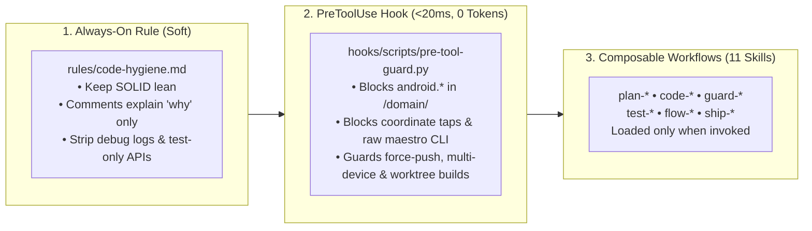

# Android Agentic SDLC (`android-agentic-sdlc`)

> 🌐 **Language:** **English** | [Tiếng Việt (README_VI.md)](./README_VI.md)
>
> 📖 **Reference:** [Command Reference & Manual Setup](./docs/COMMANDS.md)

A practical set of rules, pre-tool hooks, and composable workflows for Android developers using **Claude Code**, **Gemini CLI**, or **Antigravity**.

AI coding assistants are fast at writing isolated functions, but in a multi-module Android codebase they tend to guess missing specs, dump 2,000-line PRs, leak `android.*` imports into domain logic, and edit unrelated files when fixing bugs.

Instead of relying on longer prompts that the model eventually forgets, this toolkit adds lightweight, verifiable guardrails so you can ship small, clean PRs and verify them on an emulator before opening a Merge Request.

---

## What It Does for Daily Android Development

### 1. Turns Vague PRDs into Small, Reviewable PRs ($\le 300$ lines)
Asking an agent to build an entire feature in one shot leads to hallucinated APIs and massive diffs.
* **`/plan-feature`** reconciles PRD and Figma gaps into a single `PLAN.md` with edge cases and ready-to-send Slack questions before any code is written.
* **`/plan-slicing`** freezes shared interfaces/DTOs in `CONTRACT.md` and splits implementation into vertical steps ($\le 300$ lines per PR). Running `/clear` between `init` $\to$ `plan` $\to$ `step` keeps context fresh and prevents model drift.

### 2. Protects Clean Architecture & Prevents Regression Bugs
* **`/code-domain`** extracts pure Kotlin UseCases and sealed error models out of bloated ViewModels.
* **`hooks/scripts/pre-tool-guard.py` (`<20ms`, 0 tokens)** runs before file writes to mechanically block `import android.*` or `import androidx.*` inside `/domain/`.
* **`/test-hunter` + `/guard-blast`** separate investigation from editing: the agent must prove the root cause in read-only mode and lock an explicit **Allowlist** of files before touching production code.

### 3. Verifies Changes on Device Without Token Bloat
Once code is written, `/test-author` proves each AC live on a device via **Maestro MCP** (`inspect_screen` + batched `run`), then freezes the passing steps into deterministic YAML flows validated by `validate-flow.py` (with `extract-selectors.py` as a static fallback). On subsequent runs, `suite-runner.py` executes frozen flows in a separate terminal window so device logs never flood your LLM context.

To avoid wasting time or API credits, test execution is routed based on actual benchmarks:

| Scenario | Approach | Measured Result |
| :--- | :--- | :--- |
| **One-off UI check / layout debug** | Direct Maestro MCP | **~$0.20 cheaper** on first run (skips YAML freezing & validation). |
| **Feature / Bug fix ($\ge 2$ runs)** | `test-author` (prove & freeze) $\to$ `suite-runner.py` | **Breaks even on run #2 (-9%)**; saves **31% in total API cost** by run #10. |
| **Regression suite (frozen YAMLs)** | `suite-runner.py` (Native Python) | **~$0.71 per run** (37% cheaper across 4 ACs; cost stays flat as test count grows). |

*\*Measured across 4 ACs on 2 Android emulators (fresh sessions, median across repeated rounds, accounting for prompt-cache pricing).*

---

## How It Works: 3 Lightweight Layers

Rather than stuffing every instruction into one giant system prompt, rules are separated by how strictly they need to be enforced:



1. **Always-On Code Hygiene (`rules/code-hygiene.md`):** Loaded automatically on every coding task with zero tool overhead. Enforces early-return guard clauses, removes leftover `Log.d` calls, and stops agents from writing filler comments to justify messy code.
2. **Pre-Tool Mechanical Gate (`hooks/scripts/pre-tool-guard.py`):** LLMs forget instructions when context grows; Python scripts do not. Runs in `<20ms` before `write_file`, `edit_file`, or `run_command` to catch architectural leaks, fragile Maestro flows, and unsafe Git/ADB/Gradle commands.
3. **Human-in-the-Loop Decision Gates:** Workflows pause at **3 high-leverage checkpoints** (*Approve Diagnosis* $\to$ *Approve Reproduction* $\to$ *Approve Fix*) so you review architecture and behavior rather than line-by-line boilerplate.

---

## Everyday Workflows

### Building a Feature (`PRD` $\to$ `PR`)

```bash
# 1. Normalize PRD/Figma into a single lean plan
/plan-feature docs/prds/checkout-discount.md

# 2. Freeze shared contracts, then /clear before planning a slice
/plan-slicing init EPIC-42
# /clear
/plan-slicing plan slice-01
# /clear

# 3. Extract pure Kotlin domain logic & implement one step (<= 300 lines)
/code-domain app/src/main/java/com/app/discount/LegacyDiscountHelper.kt
/plan-slicing step slice-01 step-01

# 4. Prove ACs live via Maestro MCP & freeze validated YAML flows
/test-author plans/EPIC-42/PLAN.md --domain 04-discount

# 5. Re-run frozen flows for regression in a fresh session (0 token bleed) & ship
python3 skills/test-runner/scripts/suite-runner.py .maestro/EPIC-42/04-discount/ -m step
/ship-mr
```

### Fixing a Bug with Proof (`/flow-bug`)

```bash
/flow-bug APP-8092
```

1. **Diagnose & Lock Scope:** `test-hunter` (read-only) finds the root cause; `guard-blast` locks the editable file allowlist $\to$ **Gate 1 (You approve)**.
2. **Reproduce on Device:** `test-author` proves the defect live via Maestro MCP and freezes a failing repro YAML (`suite-runner.py -m repro` for re-checks) $\to$ **Gate 2 (You approve)**.
3. **Fix & Verify:** Applies minimal fix under `code-hygiene.md` and runs targeted regression tests via `suite-runner.py` $\to$ **Gate 3 (You approve)** $\to$ `/ship-mr`.

---

## Running Parallel Agents Safely on One Mac

Running two agents concurrently on one machine usually causes three headaches: `./gradlew installDebug` pushes APKs to *all* active emulators at once, parallel Gradle daemons exhaust Mac RAM, and `git worktree` leaves out gitignored files (`local.properties`, `google-services.json`).

Three lightweight scripts keep parallel runs isolated:

* **`scripts/init-worktree.sh <TICKET>` (`<0.2s`):** Creates `.worktrees/<TICKET>` and automatically symlinks `local.properties`, `keystore.properties`, `google-services.json`, `.agents/`, and `.claude/`.
* **`scripts/gradle-build.py`:** Uses OS-level `fcntl.flock()` semaphores and `--max-workers=2` so parallel worktrees queue builds cleanly without spiking RAM.
* **`suite-runner.py --install`:** Acquires a mutex lock on an idle emulator, sets `ANDROID_SERIAL`, installs the APK strictly to that device, and runs Maestro tests in isolation.

```bash
# Run multiple bugs and standalone tasks concurrently from a single chat prompt
/flow-queue PAY-101 (bug: crash on rotate), APP-105 (task: add date filter)
```

---

## Quick Start

### Prerequisites
* macOS or Linux with Python 3.9+, JDK 17+, and Android SDK (`adb` in `PATH`)
* [Maestro CLI](https://maestro.mobile.dev/) installed (`curl -fsSL "https://get.maestro.mobile.dev" | bash`)
* At least one running Android Emulator or connected device

### Installation

Clone this repository once, then link or copy the configuration into your Android project (or globally):

```bash
git clone https://github.com/yukido0205/android-agentic-sdlc.git
cd android-agentic-sdlc
chmod +x install.sh

# Install into a specific Android project (supports Antigravity/Gemini CLI & Claude Code)
./install.sh --project /path/to/your-android-app --target all

# Or install globally across all projects on your machine
./install.sh --global --target all
```

*(Use `--target agy` for Antigravity/Gemini CLI only, `--target claude` for Claude Code only, or add `--copy` to commit the files directly into your repo. See [`docs/COMMANDS.md`](./docs/COMMANDS.md#3-manual-installation--directory-layout) for manual setup.)*

---

## Skill Overview

Full syntax, arguments, and flags are documented in [`docs/COMMANDS.md`](./docs/COMMANDS.md).

| Phase | Skill | Purpose |
| :--- | :--- | :--- |
| **Plan** | `/plan-feature` | Turns messy PRDs/Figma links into one lean `PLAN.md` + Slack clarification questions. |
| **Plan** | `/plan-slicing` | Splits epics into `CONTRACT.md` + vertical steps ($\le 300$ lines) across fresh sessions. |
| **Code** | `/code-domain` | Extracts pure Kotlin UseCases/Entities with zero Android SDK dependencies. |
| **Diagnose** | `/test-hunter` | Read-only root-cause investigator; outputs diagnosis without touching code. |
| **Guard** | `/guard-blast` | Locks an allowlist of editable files and generates a targeted regression matrix. |
| **Verify** | `/test-author` | Proves ACs live via Maestro MCP and freezes validated YAML flows (`validate-flow.py`). |
| **Verify** | `/test-runner` | Runs frozen Maestro suites in an external terminal with live ANSI streaming & device locks. |
| **Flow** | `/flow-bug` | End-to-end bug workflow (*Diagnose* $\to$ *Repro* $\to$ *Fix* $\to$ *Verify*) with 3 approval gates. |
| **Flow** | `/flow-task` | Standalone sprint task workflow without an upfront contract file. |
| **Flow** | `/flow-queue` | Runs multiple tickets concurrently in isolated git worktrees with batched approvals. |
| **Ship** | `/ship-mr` | Audits git diffs against test logs and drafts conventional commits + PR descriptions. |
