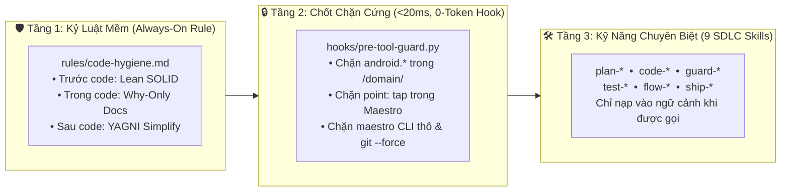
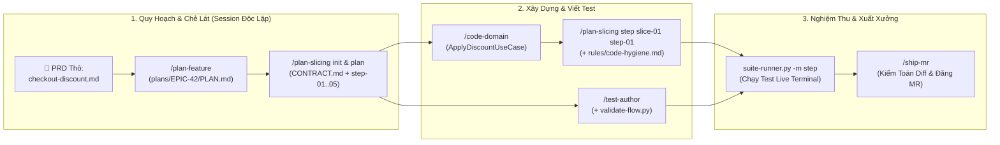
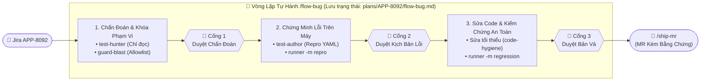
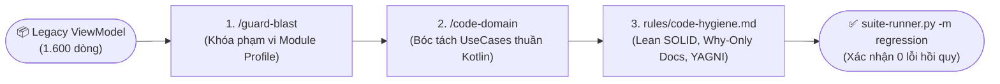

# Android Agentic SDLC (`android-agentic-sdlc`) — Bộ Kỹ Năng AI Agent Thực Chiến Cho Android/Mobile

> 🌐 **Ngôn ngữ (Language):** [English (README.md)](./README.md) | **Tiếng Việt**  
> 📐 **Case Studies & Tư Duy Kiến Trúc:** [Tiếng Việt (OVERVIEW_VI.md)](./OVERVIEW_VI.md) | [English (OVERVIEW.md)](./OVERVIEW.md)

> **Hệ thống điều phối kỹ thuật (Engineering Harness) chuẩn Production dành cho đội ngũ Android & Kotlin.**  
> Kết hợp **9 Kỹ năng AI Agent theo vòng đời SDLC**, **1 Quy tắc nền luôn bật (`rules/code-hygiene.md`)**, và **1 Chốt chặn Hook cơ học (`hooks/hooks.json`)**—biến các trợ lý lập trình AI từ công cụ sinh code tự phát thành cộng sự phát triển phần mềm có kỷ luật, kiểm soát hồi quy tuyệt đối.

---

## 1. Tại Sao Cần `android-agentic-sdlc`? (Tư Duy & Giá Trị Cốt Lõi)

Khi đưa các AI Agent thông thường vào dự án Android thực tế mà không có rào chắn chuyên biệt cho Mobile, chúng thường thất bại theo những kịch bản rất giống nhau: nhảy vào viết code ngay khi PRD còn mơ hồ, đẻ ra những PR dài hàng nghìn dòng không thể review, làm rò rỉ `import android.*` vào tầng Domain, tự ý sửa lan sang các file lân cận (scope creep), và đốt hàng trăm nghìn token khi chạy test UI.

`android-agentic-sdlc` giải quyết tận gốc vấn đề này bằng cách thay thế việc "nhắc bài bằng prompt thủ công" bằng một **hệ thống kỹ thuật có tính tất định (deterministic SDLC system)**:

| Điểm Nghẽn Thực Tế | ❌ AI Agent Thông Thường (Tự Phát) | ✅ Với `android-agentic-sdlc` (Có Kỷ Luật) |
| :--- | :--- | :--- |
| **Yêu cầu PRD/Figma mơ hồ** | Tự đoán mò các luồng ngoại lệ rồi nhảy vào code ngay, hoặc đẻ ra 4–5 file tài liệu rời rạc gây quá tải. | **`/plan-feature`** gom toàn bộ PRD/Figma về đúng 1 file `PLAN.md`, chuẩn hóa User Story theo Tam giác Dị thường kèm mẫu tin nhắn Slack hỏi PM/BE. |
| **PR khổng lồ & Loãng ngữ cảnh** | Quét cả Epic trong 1 phiên chat, bị ảo giác (hallucination) và tạo ra PR dài hơn 2.000 dòng. | **`/plan-slicing`** áp dụng **Quy hoạch cuốn chiếu 3 tầng (JIT)** qua các phiên `/clear` độc lập—ép mỗi MR **$\le 300$ dòng code**. |
| **Kiến trúc Android rối rắm** | Trộn lẫn `Context`, `SharedPreferences` và UI state trong ViewModel 1.500 dòng; quên sạch rule Clean Architecture khi chat dài. | **`/code-domain`** bóc tách UseCase thuần Kotlin, đồng thời **`pre-tool-guard.py`** chặn cơ học mọi lệnh `import android.*` trong `/domain/`. |
| **Sửa bug kiểu "thử và sai"** | Vừa đọc stack trace đã vội sửa code theo phỏng đoán, làm phát sinh lỗi ngầm ở các module khác. | **`/test-hunter`** (chỉ đọc) điều tra nguyên nhân gốc trước; **`/guard-blast`** khóa cứng danh sách file được phép chạm vào (**Allowlist**). |
| **Test UI chập chờn & Đốt token** | Dùng tọa độ chạm cứng (`point: x, y`) và gọi Maestro liên tiếp qua LLM làm bốc hơi hàng trăm nghìn token. | **`/test-author`** ép dùng selector ngữ nghĩa; **`suite-runner.py`** chạy test trực tiếp bằng Python, stream ANSI live với **0 token LLM bị lãng phí**. |

### 4 Triết Lý Kỹ Thuật Cốt Lõi (Core Design Pillars)

1. **Vệ Sinh Ngữ Cảnh Bằng Quy Hoạch Cuốn Chiếu 3 Tầng (3-Tier JIT Slicing):** LLM sẽ suy giảm trí thông minh khi phải ôm đồm toàn bộ Epic trong một phiên làm việc. Hệ thống lưu trạng thái vào 2 file tinh gọn (`PLAN.md` & `CONTRACT.md`) và chủ động xóa sạch bộ nhớ phiên (`/clear`) giữa 3 chặng: **Lead chốt Contract $\to$ Chia khung Slice $\to$ Code từng Step**.
2. **Thực Thi Cơ Học Tốn 0 Token (Zero-Token-Bleed Execution):** Không bao giờ dùng token LLM để làm công việc lặp lại của máy tính. Việc kiểm tra cú pháp tĩnh, chặn lỗi vi phạm kiến trúc (`<20ms`) và chạy hàng trăm kịch bản Maestro (~270 flows) đều được đẩy xuống script Python native.
3. **Chẩn Đoán Trước Khi Sửa & Khóa Vùng Ảnh Hưởng (Blast Radius Containment):** Tách bạch tuyệt đối giữa *Điều tra* và *Thay đổi code*. Agent không được phép sửa bất kỳ dòng code nào cho đến khi chứng minh được nguyên nhân gốc (`test-hunter`) và khóa xong danh sách file được phép sửa (`guard-blast`).
4. **Con Người Duyệt Ở Đúng 3 Điểm Đòn Bẩy (High-Leverage Human Gates):** Thay vì làm phiền lập trình viên bằng hàng chục câu hỏi lặt vặt—hoặc tự ý chạy mù quáng từ đầu đến cuối—quy trình tự động dừng lại xin phê duyệt ở đúng **3 cổng quyết định rủi ro cao nhất** (*Duyệt Chẩn Đoán $\to$ Duyệt Tái Hiện Lỗi $\to$ Duyệt Bản Vá*).

---

## 2. Kiến Trúc Hệ Thống: Mô Hình Phòng Thủ 3 Tầng (The 3-Layer Defense)

Thay vì nhồi nhét mọi hướng dẫn vào các prompt khổng lồ, hệ thống phân tách trách nhiệm dựa trên **mức độ bắt buộc và tần suất thực thi**:



### 🛡️ Tầng 1: Quy Tắc Nền Luôn Bật (`rules/code-hygiene.md`) — *Kỷ Luật Mềm (Soft Invariant)*
Chất lượng code là nguyên tắc bất biến, không phải bước tùy chọn. Quy tắc này tự động nạp trong mọi tác vụ mà **không tốn thêm lượt gọi công cụ (0 tool-call overhead)**:
- **Trước khi code (Lean SOLID):** Chặn đứng bệnh over-engineering và việc tạo interface chỉ có 1 implementation.
- **Trong khi code (Why-Only Docs):** Cấm viết comment dịch lại cú pháp code; bắt buộc kiểm chứng mọi mệnh đề nhân quả trong comment.
- **Sau khi code (YAGNI Simplify):** Làm phẳng câu lệnh điều kiện bằng guard clauses (early returns), xóa sạch `Log.d` tạm và cấm mở `public` chỉ để phục vụ unit test.

### 🔒 Tầng 2: Chốt Chặn Sự Kiện Trước Khi Gọi Công Cụ (`hooks/hooks.json` & `pre-tool-guard.py`) — *Kỷ Luật Cứng (Hard Gate)*
LLM có thể quên lời dặn khi hội thoại dài ra, nhưng script Python thì không. Chạy đồng bộ trong **<20ms** với **chi phí 0 token** ngay trước khi Agent gọi `write_file`, `edit_file` hoặc `run_command`:
- **`[domain-purity-guard]`:** Từ chối ngay lập tức (`deny`) nếu AI cố tình ghi/sửa file `.kt` trong thư mục `/domain/` mà có chứa `import android.*` hoặc `import androidx.*`.
- **`[maestro-static-gate]`:** Từ chối (`deny`) ngay lúc lưu file `.maestro/**/*.yaml` nếu đặt sai tên chuẩn `ac-NN-<slug>.yaml`, dùng tọa độ chạm cứng (`point: x, y`), hoặc quên viết câu lệnh `assertVisible`/`assertTrue`.
- **`[command-safety-guard]`:** Từ chối (`deny`) lệnh chạy `maestro test` thô trên terminal (bắt buộc đi qua `suite-runner.py` để chống tràn token) và bật hộp thoại xác nhận bắt buộc (`force_ask`) với các lệnh nguy hiểm (`git reset --hard`, `git push --force`, `adb uninstall`).

### 🛠️ Tầng 3: Danh Mục 9 Kỹ Năng Chuyên Biệt (`skills/`) — *Quy Trình Theo Ngữ Cảnh*

| Kỹ năng (Skill) | Thư mục | Lệnh kích hoạt / CLI | Nhóm SDLC | Vai trò cốt lõi |
| :--- | :--- | :--- | :--- | :--- |
| **`plan-feature`** | `skills/plan-feature` | `/plan-feature <PRD/Brief>` | Plan | Chuyển đổi PRD/Figma sơ sài thành một tài liệu tinh gọn duy nhất `plans/<EPIC>/PLAN.md`. |
| **`plan-slicing`** | `skills/plan-slicing` | `/plan-slicing init\|plan\|step` | Plan | Chẻ nhỏ Epic thành các lát cắt dọc song song trên Mock ($\le 300$ dòng/MR) qua `CONTRACT.md`. |
| **`code-domain`** | `skills/code-domain` | `/code-domain <file>` | Code (Domain) | Bóc tách logic nghiệp vụ thành các UseCase/Entity pure Kotlin, hoàn toàn không dính Android SDK. |
| **`test-hunter`** | `skills/test-hunter` | `/test-hunter <ticket\|log>` | Test (Chẩn đoán) | Chuyên gia điều tra nguyên nhân gốc (chỉ đọc — không sửa code). Xuất báo cáo `DIAGNOSIS`. |
| **`guard-blast`** | `skills/guard-blast` | `/guard-blast <target>` | Guard (An toàn) | Tính toán Blast Radius, khóa chặt danh sách file được sửa (Allowlist) và lập ma trận regression. |
| **`test-author`** | `skills/test-author` | `/test-author <target>` | Test (Soạn thảo) | Viết kịch bản test Maestro YAML chuẩn ngữ nghĩa, kiểm tra tĩnh qua `validate-flow.py`. |
| **`test-runner`** | `skills/test-runner` | `/test-runner <target> [-m ...]` hoặc CLI | Test (Thực thi) | Bộ chạy test quy mô lớn, stream live ANSI ra terminal, chụp màn hình lỗi và 0 tốn token khi pass. |
| **`flow-bug`** | `skills/flow-bug` | `/flow-bug <TICKET>` | Flow (Nhạc trưởng) | Điều phối toàn diện vòng đời bug (Hiểu $\to$ Sửa $\to$ Chứng minh $\to$ Ship), người chỉ duyệt 3 cổng. |
| **`ship-mr`** | `skills/ship-mr` | `/ship-mr` | Ship (Xuất xưởng) | Kiểm toán git diff, đối chiếu mệnh đề nhân quả và bằng chứng test; tạo commit & nội dung MR. |

---

## 3. Sức Mạnh Cộng Hưởng: 3 Chuỗi Giá Trị Thực Chiến (Synergy Pipelines)

Mỗi kỹ năng giải quyết một nút thắt riêng, nhưng sức mạnh thực sự nằm ở cách chúng kết nối thành dây chuyền khép kín:

### Chuỗi 1: Phát Triển Tính Năng Từ Đầu Đến Cuối (PRD Thô $\to$ Production MR)

**Tình huống thực tế:** Triển khai tính năng áp dụng mã giảm giá khuyến mãi cho khách hàng (`EPIC-42: Customer Checkout Voucher Discount`).



**Chi tiết các bước thực hiện:**
1. **Hợp nhất yêu cầu:**
   ```bash
   /plan-feature docs/prds/checkout-discount.md
   ```
   *Kết quả:* Agent phân tích Figma và PRD, sinh ra `plans/EPIC-42/PLAN.md` với 3 User Stories và đoạn chat Slack hỏi PM/BE dựng sẵn.

2. **Tạo hợp đồng & Quy hoạch cuốn chiếu theo từng Session sạch (`/clear`):**
   ```bash
   # Session 1 (Lead): Chốt CONTRACT.md & bảng Slices Overview, sau đó /clear
   /plan-slicing init EPIC-42

   # Session 2 (Dev nhận slice-01): Chỉ lập khung các bước (step-01..step-05) cho riêng slice-01, sau đó /clear
   /plan-slicing plan slice-01
   ```
   *Kết quả:* Tạo `plans/EPIC-42/CONTRACT.md` định nghĩa interface `VoucherRepository` và data class `DiscountResult`, sau đó lên khung 5 bước `step-01..step-05` ($\le 250$ dòng code mỗi bước) cho riêng `slice-01` trong `plans/EPIC-42/PLAN.md §4` mà không bị ảo giác sang các Slice khác.

3. **Mỗi Step 1 Session Riêng: Tự quét code, bóc tách Domain & Hiện thực hóa (Dưới sự giám sát của `rules/code-hygiene.md`):**
   ```bash
   # Session 3 (Dev thực thi step-01): Chỉ quét code liên quan step-01, lập micro-plan và code step-01
   /code-domain app/src/main/java/com/app/discount/LegacyDiscountHelper.kt
   /plan-slicing step slice-01 step-01
   ```
   *Kết quả:* `code-domain` bóc tách logic thành `CalculateVoucherDiscountUseCase.kt` và `DiscountError.kt` thuần túy, hoàn toàn không phụ thuộc Android UI. Quy tắc nền `rules/code-hygiene.md` tự động chặn wrapper thừa, ép comment giải thích "Why" và dọn sạch code.

4. **Viết & Kiểm tra tĩnh kịch bản test:**
   ```bash
   /test-author plans/EPIC-42/PLAN.md --domain 04-discount
   python3 skills/test-author/scripts/validate-flow.py .maestro/EPIC-42/04-discount/
   ```
   *Kết quả:* Kịch bản test Maestro được tạo và kiểm duyệt tại `.maestro/EPIC-42/04-discount/ac-01-apply-valid-voucher.yaml`.

5. **Nghiệm thu trên thiết bị thật & Tạo MR:**
   ```bash
   python3 skills/test-runner/scripts/suite-runner.py .maestro/EPIC-42/04-discount/ -m step
   /ship-mr
   ```
   *Kết quả:* Cửa sổ Terminal mở ra và stream trực tiếp kết quả chạy test trên emulator. Khi toàn bộ step pass, `/ship-mr` kiểm toán diff, xác nhận bằng chứng test và soạn thảo MR hoàn chỉnh.

---

### Chuỗi 2: Xử Lý Lỗi Khép Kín Với Độ Tin Cậy Tuyệt Đối (Jira $\to$ Bản Vá Được Chứng Minh)

**Tình huống thực tế:** Báo cáo lỗi khách hàng `APP-8092: App bị văng lỗi NullPointerException khi thanh toán giỏ hàng rỗng`.



---

### Chuỗi 3: Hiện Đại Hóa Code Cũ & Bóc Tách Kiến Trúc Sạch (Legacy Modernization)

**Tình huống thực tế:** Tái cấu trúc file `UserProfileViewModel.kt` dài 1.600 dòng đang trực tiếp đọc `SharedPreferences` và gọi API network ngay trong hàm xử lý UI.



---

## 4. Yêu Cầu Môi Trường & Hướng Dẫn Cài Đặt (Installation Guide)

### 4.1. Yêu Cầu Môi Trường (Prerequisites)
- **Hệ điều hành:** macOS (khuyến nghị để mở cửa sổ AppleScript Terminal stream trực tiếp) hoặc Linux.
- **Môi trường chạy:** Python 3.9+, JDK 17+, Android SDK.
- **Công cụ dòng lệnh bắt buộc:**
  - `adb` đã cấu hình trong PATH hệ thống (`adb devices`).
  - [Maestro CLI](https://maestro.mobile.dev/) đã cài đặt (`curl -fsSL "https://get.maestro.mobile.dev" | bash`).
- **Thiết bị chạy:** Android Emulator hoặc máy thật đã bật chế độ USB debugging.

### 4.2. Cài Đặt Tự Động Bằng 1 Lệnh (`install.sh` — Hỗ Trợ Antigravity, Gemini CLI & Claude Code)

Clone bộ công cụ này về máy, sau đó chạy [`install.sh`](./install.sh) để tạo symlink (hoặc `--copy`) toàn bộ 9 Skills, 1 Rule và 1 Hook vào dự án Android hoặc cài Global cho toàn máy:

```bash
git clone https://github.com/yukido0205/android-agentic-sdlc.git
cd android-agentic-sdlc
chmod +x install.sh
```

#### Cách A: Cài vào một Dự Án Android cụ thể (Workspace Scope — Khuyên dùng cho Team)
```bash
# Cài đồng thời cho cả Antigravity/Gemini CLI (.agents/) và Claude Code (.claude/)
./install.sh --project /duong/dan/toi/android-app --target all

# Hoặc chỉ cài cho Antigravity & Gemini CLI (.agents/)
./install.sh --project /duong/dan/toi/android-app --target agy

# Hoặc chỉ cài cho Claude Code (.claude/)
./install.sh --project /duong/dan/toi/android-app --target claude

# Mẹo: Thêm cờ `--copy` nếu bạn muốn copy hẳn file vào repo Android để commit chung cho cả team thay vì dùng symlink
./install.sh --project /duong/dan/toi/android-app --target agy --copy
```

#### Cách B: Cài Global cho mọi dự án trên máy cá nhân
```bash
# Cài Global vào ~/.gemini/config/ (Antigravity & Gemini CLI) và ~/.claude/ (Claude Code)
./install.sh --global --target all
```

### 4.3. Bảng Đường Dẫn Cài Đặt Thủ Công (Nếu không dùng `install.sh`)
Nếu muốn tự copy hoặc tạo symlink thủ công, bạn chỉ cần đặt đúng vào cấu trúc thư mục chuẩn của từng công cụ:

| Nền tảng AI Agent | Đường dẫn theo từng Project (Workspace) | Đường dẫn toàn máy (Global) |
| :--- | :--- | :--- |
| **Antigravity & Gemini CLI** | `<android-repo>/.agents/skills/*`<br>`<android-repo>/.agents/rules/code-hygiene.md`<br>`<android-repo>/.agents/hooks.json`<br>`<android-repo>/.agents/hooks/scripts/pre-tool-guard.py` | `~/.gemini/config/skills/*`<br>`~/.gemini/config/rules/code-hygiene.md`<br>`~/.gemini/config/hooks.json`<br>`~/.gemini/config/hooks/scripts/pre-tool-guard.py` |
| **Claude Code** | `<android-repo>/.claude/skills/*`<br>`<android-repo>/.claude/rules/code-hygiene.md`<br>`<android-repo>/.claude/hooks/scripts/pre-tool-guard.py` | `~/.claude/skills/*`<br>`~/.claude/rules/code-hygiene.md`<br>`~/.claude/hooks/scripts/pre-tool-guard.py` |

---

## 5. Cẩm Nang Tra Cứu Chi Tiết Cho 9 Kỹ Năng Cốt Lõi

### 5.1. `plan-feature` — Chuẩn Hóa Yêu Cầu & Kịch Bản User Story
- **Khi nào sử dụng:** Khi bắt đầu một tính năng mới từ file PRD thô, link thiết kế Figma, epic Jira hoặc yêu cầu sơ khai từ người dùng.
- **Lệnh kích hoạt / Cú pháp:**
  ```bash
  /plan-feature docs/prds/checkout-discount-prd.md
  # hoặc
  /plan-feature "Xây dựng tính năng đăng nhập sinh trắc học cho người dùng"
  ```
- **Đầu vào:** Văn bản mô tả yêu cầu, file tài liệu PRD (.md), hoặc prompt của người dùng.
- **Đầu ra:** Tạo hoặc cập nhật file sống `plans/<EPIC>/PLAN.md` chứa: tài liệu yêu cầu hợp nhất, các câu hỏi tự thân kèm mẫu tin nhắn Slack hỏi PM/BE, danh sách User Stories tập trung vào Anomaly Triangle, và bảng đánh giá rủi ro kỹ thuật.

---

### 5.2. `plan-slicing` — Quy Hoạch Cuốn Chiếu 3 Tầng (JIT) & Chẻ Lát Cắt Dọc
- **Khi nào sử dụng:** Khi cần chia nhỏ các User Stories của một Epic thành các lát cắt dọc độc lập ($\le 300$ dòng code/MR) mà không bắt AI phải quét và lập kế hoạch chi tiết cho toàn bộ Epic cùng lúc (tránh loãng ngữ cảnh và hallucination).
- **Lệnh kích hoạt / Cú pháp (3 Tầng Session Độc Lập — Lưu trạng thái vào File, `/clear` giữa mỗi tầng):**
  ```bash
  # Tầng 1 (Session của Lead): Chốt CONTRACT.md & bảng Slices Overview (NOT PLANNED), sau đó /clear
  /plan-slicing init ORDER-DISCOUNT

  # Tầng 2 (Fresh Session của Dev nhận slice-01): Chỉ chia khung Steps (step-01..step-05) cho đúng slice-01, sau đó /clear
  /plan-slicing plan slice-01

  # Tầng 3 (Mỗi Step 1 Fresh Session riêng): Tự quét code của riêng step-01, lên micro-plan, code, test & tạo MR, sau đó /clear
  /plan-slicing step slice-01 step-01
  ```
- **Đầu vào:** `plans/<EPIC>/PLAN.md`.
- **Đầu ra:** File hợp đồng `plans/<EPIC>/CONTRACT.md` (interface, mock DTOs) và danh sách các bước lát cắt trực tiếp trong `plans/<EPIC>/PLAN.md §4` (Kiến trúc 2-File tinh gọn).

---

### 5.3. `code-domain` — Bóc Tách Logic Nghiệp Vụ Sạch Khỏi Code Cũ
- **Khi nào sử dụng:** Khi tái cấu trúc các ViewModel, Activity hoặc Helper cũ dài hàng nghìn dòng, bóc tách toàn bộ business rules thành tầng Clean Architecture Pure Kotlin.
- **Lệnh kích hoạt / Cú pháp:**
  ```bash
  /code-domain app/src/main/java/com/app/user/UserViewModel.kt
  ```
- **Đầu vào:** File mã nguồn Kotlin chứa logic lẫn lộn với Android SDK.
- **Đầu ra:**
  - Tự động thẩm định độ phức tạp (khuyên bỏ qua nếu chỉ là CRUD đơn giản).
  - Xuất tài liệu đặc tả nghiệp vụ: `docs/domain/<feature_name>.md` và dừng ở cổng duyệt **Approval Gate**.
  - Sinh ra các UseCases (`ApplyDiscountUseCase.kt`), Entities và Sealed Errors thuần Kotlin, hoàn toàn không có `import android.*`.

---

### 5.4. `test-hunter` — Kỹ Sư Điều Tra Nguyên Nhân Gốc (Chỉ Đọc)
- **Khi nào sử dụng:** Khi phân tích ticket Jira, crash log, hoặc stack trace mà không muốn AI tự ý sửa code lung tung.
- **Lệnh kích hoạt / Cú pháp:**
  ```bash
  /test-hunter "APP-8092: Bị crash ANR khi người dùng bấm xác nhận đơn hàng không có sản phẩm"
  # hoặc
  /test-hunter crash-logs/anr-trace.txt
  ```
- **Đầu vào:** Mô tả lỗi, stack trace, hoặc file logcat.
- **Đầu ra:** Báo cáo `DIAGNOSIS` chỉ rõ cơ chế gây lỗi, điều kiện tái hiện và danh sách các file mã nguồn liên quan. **(Tuyệt đối không sửa một dòng code nào).**

---

### 5.5. `guard-blast` — Kiểm Soát Phạm Vi Ảnh Hưởng & Lập Ma Trận Test
- **Khi nào sử dụng:** Ngay sau bước chẩn đoán lỗi trong quy trình sửa bug, hoặc khi có thay đổi yêu cầu PRD giữa chừng.
- **Lệnh kích hoạt / Cú pháp:**
  ```bash
  # Chế độ 1: So sánh delta tài liệu yêu cầu PRD
  /guard-blast spec docs/prds/v1.md docs/prds/v2.md

  # Chế độ 2: Khoanh vùng phạm vi sửa bug & lập Allowlist
  /guard-blast plans/APP-8092/flow-bug.md
  ```
- **Đầu vào:** Báo cáo chẩn đoán từ `test-hunter` hoặc diff giữa 2 phiên bản PRD.
- **Đầu ra:** Thiết lập danh sách các file được phép sửa (**Allowlist**) và ma trận test hồi quy 3 cấp độ (`plans/<TICKET>/regression-plan.md`).

---

### 5.6. `test-author` — Tự Động Viết & Kiểm Tra Tĩnh Test Maestro YAML (Code-First ID Extraction)
- **Khi nào sử dụng:** Tạo kịch bản kiểm thử giao diện Maestro E2E chuẩn xác dựa trên tiêu chí nghiệm thu của User Story hoặc luồng tái hiện lỗi theo quy trình **Code-First ID Extraction** (Tĩnh trước, Động là Fallback: ưu tiên đọc XML `android:id` và Compose `Modifier.testTag` trực tiếp từ source code nhanh gấp 10 lần và tốn ~0 token thiết bị; chỉ fallback sang `device.py nodes` khi gặp Server-Driven UI hoặc không có ID tĩnh).
- **Lệnh kích hoạt / Cú pháp:**
  ```bash
  # Bước 1: Agent trích xuất AC từ PLAN.md hoặc flow-bug.md, quét ID từ code và tạo kịch bản Maestro YAML
  /test-author plans/APP-8092/flow-bug.md --domain 02-checkout

  # CLI bổ trợ: Quét nhanh toàn bộ XML android:id, Compose testTag & strings.xml theo từ khóa
  python3 skills/test-author/scripts/extract-selectors.py app/src/main -k "checkout"

  # Bước 2: Kiểm tra tĩnh (chặn bấm tọa độ, thiếu assert, sai tên file)
  python3 skills/test-author/scripts/validate-flow.py .maestro/APP-8092/
  ```
- **Đầu vào:** Tiêu chí nghiệm thu (Given/When/Then) hoặc kịch bản tái hiện bug trong `PLAN.md` / `flow-bug.md`.
- **Đầu ra:** File test Maestro YAML hoàn chỉnh (ví dụ: `.maestro/APP-8092/02-checkout/ac-01-repro.yaml`) sử dụng selector bare ID / Compose `testTag` / text bền vững, sẵn sàng giao cho `suite-runner.py` chạy CLI một mạch.

---

### 5.7. `test-runner` — Bộ Chạy Test Tinh Gọn Trên Thiết Bị
- **Khi nào sử dụng:** Chạy một test tái hiện, test từng bước lát cắt, kiểm tra thông số Figma hoặc chạy toàn bộ bộ test hồi quy trên thiết bị Android/máy ảo.
- **Cách kích hoạt 1: Gọi trực tiếp trong Cửa sổ Chat của Agent (Slash Command & Ngôn ngữ tự nhiên):**
  - **Dùng Slash Command tường minh:**
    ```text
    # Chạy test cho 1 bước lát cắt trong cửa sổ streaming terminal riêng
    /test-runner .maestro/02-checkout/ -m step

    # Chạy nhanh tái hiện lỗi bug trong tiến trình (timeout 15s)
    /test-runner plans/APP-8092/flow-bug.md -m repro

    # Chạy toàn bộ suite hồi quy có monitor ANSI trực tiếp
    /test-runner plans/APP-8092/flow-bug.md -m regression

    # Chạy smoke test ở chế độ headless (không mở terminal ngoài, in kết quả thẳng vào chat)
    /test-runner .maestro/ -m smoke --headless
    ```
  - **Dùng Ngôn ngữ tự nhiên:**
    - `"run regression"` hoặc `"chạy regression cho tôi"` $\to$ chạy mode regression
    - `"test APP-8092"` hoặc `"verify step-03"` $\to$ chạy mode step
    - `"repro bug APP-8092"` $\to$ chạy mode repro
    - `"chạy smoke test"` $\to$ chạy mode smoke
- **Cách kích hoạt 2: Chạy trực tiếp qua dòng lệnh CLI (Terminal / Shell / CI):**
  ```bash
  # Mode 'repro': Chạy nhanh trong tiến trình hiện tại để tái hiện bug
  python3 skills/test-runner/scripts/suite-runner.py plans/APP-8092/flow-bug.md -m repro

  # Mode 'step': Chạy test cho 1 bước lát cắt trong cửa sổ terminal stream riêng biệt
  python3 skills/test-runner/scripts/suite-runner.py .maestro/02-checkout/ -m step

  # Mode 'regression': Chạy toàn bộ bộ test, tự reset trạng thái app, stream ANSI live và hỗ trợ resume
  python3 skills/test-runner/scripts/suite-runner.py plans/APP-8092/flow-bug.md -m regression

  # Mode 'smoke': Chạy nhanh các test gắn tag @smoke trước khi commit
  python3 skills/test-runner/scripts/suite-runner.py .maestro/ -m smoke

  # Cờ Headless: Tắt cửa sổ terminal ngoài, chạy thẳng trong shell (cho CI/CD hoặc background)
  python3 skills/test-runner/scripts/suite-runner.py .maestro/ -m regression --headless
  ```
- **Đầu vào:** Thư mục chứa kịch bản Maestro, file YAML đơn lẻ hoặc file trạng thái markdown chứa ma trận test.
- **Đầu ra:** Cửa sổ Terminal stream ANSI trực tiếp, `progress.log`, thư mục báo cáo lỗi `issues/`, và thống kê token sử dụng.

---

### 5.8. `flow-bug` — Nhạc Trưởng Tự Động Hóa Toàn Diện Vòng Đời Bug
- **Khi nào sử dụng:** Khi muốn xử lý trọn gói 1 bug từ Jira chỉ bằng 1 câu lệnh duy nhất (Hiểu $\to$ Sửa $\to$ Chứng minh $\to$ Xuất xưởng).
- **Lệnh kích hoạt / Cú pháp:**
  ```bash
  # Bắt đầu xử lý lỗi
  /flow-bug APP-8092

  # Tiếp tục phiên làm việc dở dang
  /flow-bug resume APP-8092
  ```
- **Đầu vào:** Mã ticket Jira hoặc tiêu đề lỗi.
- **Đầu ra:** File theo dõi trạng thái `plans/<TICKET>/flow-bug.md`, bản vá code đã được kiểm chứng trên thiết bị, và branch git sẵn sàng merge.

---

### 5.9. `ship-mr` — Kiểm Toán Diff & Soạn Thảo Merge Request Kèm Bằng Chứng
- **Khi nào sử dụng:** Sau khi hoàn thành code và test, cần kiểm toán lại diff và viết nội dung PR chỉn chu.
- **Lệnh kích hoạt / Cú pháp:**
  ```bash
  /ship-mr
  ```
- **Đầu vào:** Git diff đã staged và file log kết quả test.
- **Đầu ra:** Thông điệp commit chuẩn Conventional Commit và nội dung mô tả Merge Request định dạng Markdown có đính kèm đầy đủ bằng chứng test thực tế.

---

## 6. Cấu Trúc Thư Mục Repository

```text
android-agentic-sdlc/
├── OVERVIEW.md                   # Case study kiến trúc & nguồn gốc ra đời (Tiếng Anh)
├── OVERVIEW_VI.md                # Case study kiến trúc & nguồn gốc ra đời (Tiếng Việt)
├── README.md                     # Hướng dẫn sử dụng & 3 chuỗi kết hợp (Tiếng Anh)
├── README_VI.md                  # Hướng dẫn sử dụng & 3 chuỗi kết hợp (Tiếng Việt)
├── install.sh                    # Script cài đặt 1 chạm cho Antigravity, Gemini CLI & Claude Code
├── hooks/
│   ├── hooks.json                # Cấu hình PreToolUse lifecycle hook
│   └── scripts/
│       └── pre-tool-guard.py     # Chốt chặn cơ học <20ms (Domain purity, Maestro YAML, CLI safety)
├── rules/
│   └── code-hygiene.md           # Quy tắc nền luôn bật: Lean SOLID + Why-only Docs + YAGNI Simplify
└── skills/
    ├── plan-feature/             # Chuẩn hóa PRD thành Plan tinh gọn
    ├── plan-slicing/             # Chẻ nhỏ Epic thành các lát cắt dọc song song
    ├── code-domain/              # Bóc tách logic Clean Architecture
    ├── test-hunter/              # Chuyên gia điều tra root cause (chỉ đọc)
    ├── guard-blast/              # Phân tích blast radius & bảo vệ regression
    ├── test-author/              # Bộ tạo & kiểm tra tĩnh kịch bản test Maestro YAML
    ├── test-runner/              # Bộ chạy test trên thiết bị & stream terminal
    ├── flow-bug/                 # Nhạc trưởng điều phối sửa bug khép kín
    └── ship-mr/                  # Kiểm toán diff & viết mô tả Merge Request
```
