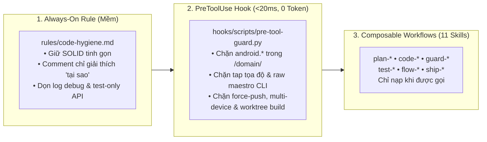

# Android Agentic SDLC (`android-agentic-sdlc`)

> 🌐 **Ngôn ngữ:** [English (README.md)](./README.md) | **Tiếng Việt**
>
> 📖 **Tài liệu tra cứu:** [Command Reference & Cài đặt thủ công](./docs/COMMANDS.md)

Bộ quy tắc (rules), pre-tool hooks và workflow lắp ghép dành cho lập trình viên Android dùng **Claude Code**, **Gemini CLI**, hoặc **Antigravity**.

Các trợ lý AI viết từng hàm độc lập rất nhanh, nhưng khi thả vào codebase Android nhiều module, chúng thường tự đoán spec còn thiếu, xả ra PR 2.000 dòng, làm rò rỉ `import android.*` vào tầng domain, và sửa lan sang các file không liên quan khi fix bug.

Thay vì viết system prompt ngày càng dài để rồi model dần quên, bộ công cụ này bổ sung các lớp bảo vệ nhẹ và kiểm chứng được để bạn ship PR nhỏ, sạch và kiểm thử thực tế trên emulator trước khi mở Merge Request.

---

## Công cụ này giúp gì cho việc dev Android hằng ngày?

### 1. Biến PRD mơ hồ thành các PR nhỏ, dễ review ($\le 300$ dòng)
Yêu cầu AI code cả tính năng trong một phiên chat dễ dẫn đến bịa API và tạo diff khổng lồ.
* **`/plan-feature`** đối chiếu PRD và Figma thành một file `PLAN.md` duy nhất kèm edge cases và câu hỏi Slack sẵn sàng gửi đi trước khi viết dòng code nào.
* **`/plan-slicing`** đóng băng interface/DTO dùng chung trong `CONTRACT.md` và chia nhỏ thành các vertical step ($\le 300$ dòng/PR). Chạy `/clear` giữa `init` $\to$ `plan` $\to$ `step` giúp context luôn sạch và tránh model bị trôi ngữ cảnh.

### 2. Bảo vệ Clean Architecture & Chặn lỗi hồi quy (Regression)
* **`/code-domain`** tách UseCase Kotlin thuần và sealed error model ra khỏi các ViewModel phình to.
* **`hooks/scripts/pre-tool-guard.py` (`<20ms`, 0 token)** chạy trước khi ghi file để chặn cứng `import android.*` hoặc `import androidx.*` bên trong `/domain/`.
* **`/test-hunter` + `/guard-blast`** tách biệt hoàn toàn bước chẩn đoán và bước sửa code: agent phải chứng minh root cause ở chế độ chỉ đọc (read-only) và khóa **Allowlist** các file được phép sửa trước khi đụng vào production code.

### 3. Kiểm thử trên thiết bị thực mà không tràn token
Sau khi code xong, `/test-author` chứng minh trực tiếp từng AC trên máy qua **Maestro MCP** (`inspect_screen` + gom nhóm `run`), sau đó đóng băng các bước đã pass thành file YAML xác định được kiểm tra bởi `validate-flow.py` (kèm `extract-selectors.py` làm phương án fallback quét tĩnh). Ở các lần chạy lại, `suite-runner.py` chạy các flow đã đóng băng trên một cửa sổ terminal riêng để log thiết bị không bao giờ làm ngập context LLM.

Để tối ưu cả thời gian lẫn chi phí API, luồng chạy test được điều phối theo benchmark đo thực tế:

| Tình huống | Cách tiếp cận | Kết quả đo thực tế |
| :--- | :--- | :--- |
| **Kiểm tra UI 1 lần / debug layout** | Gọi trực tiếp Maestro MCP | **Rẻ hơn ~$0.20** ở lần chạy đầu (bỏ qua bước đóng băng & validate YAML). |
| **Feature / Bug fix ($\ge 2$ lần chạy)** | `test-author` (prove & freeze) $\to$ `suite-runner.py` | **Hòa vốn ngay ở lần chạy #2 (-9%)**; tiết kiệm **31% tổng chi phí API** sau 10 lần chạy. |
| **Chạy regression (YAML đã đóng băng)** | `suite-runner.py` (Python thuần) | **~$0.71 mỗi lần chạy** (rẻ hơn 37% trên bộ 4 AC; chi phí gần như đi ngang khi số test tăng). |

*\*Đo trên 4 AC với 2 Android emulator (session mới, trung vị qua các vòng lặp R4–R8, đã tính giá prompt-cache).*

---

## Cơ chế hoạt động: 3 lớp gọn nhẹ

Thay vì nhồi mọi hướng dẫn vào một prompt khổng lồ, các quy tắc được tách theo mức độ bắt buộc:



1. **Always-On Code Hygiene (`rules/code-hygiene.md`):** Tự động nạp cho mọi tác vụ code với 0 chi phí gọi tool. Ép dùng guard clause (early-return), dọn `Log.d` thừa và chặn agent viết comment sáo rỗng để biện minh cho code rối.
2. **Pre-Tool Mechanical Gate (`hooks/scripts/pre-tool-guard.py`):** LLM có thể quên hướng dẫn khi context phình to, còn script Python thì không. Chạy trong `<20ms` trước `write_file`, `edit_file` hoặc `run_command` để chặn rò rỉ kiến trúc, flow Maestro thiếu ổn định và các lệnh Git/ADB/Gradle nguy hiểm.
3. **Human-in-the-Loop Decision Gates:** Workflow dừng lại đúng **3 chốt duyệt giá trị cao** (*Duyệt Chẩn đoán* $\to$ *Duyệt Tái hiện lỗi* $\to$ *Duyệt Bản vá*) để bạn tập trung review kiến trúc và hành vi thay vì soi từng dòng boilerplate.

---

## Các luồng làm việc hằng ngày

### Xây dựng tính năng mới (`PRD` $\to$ `PR`)

```bash
# 1. Chuẩn hóa PRD/Figma thành một file kế hoạch gọn nhẹ
/plan-feature docs/prds/checkout-discount.md

# 2. Đóng băng contract dùng chung, sau đó /clear trước khi cắt slice
/plan-slicing init EPIC-42
# /clear
/plan-slicing plan slice-01
# /clear

# 3. Tách domain logic Kotlin thuần & triển khai từng step (<= 300 dòng)
/code-domain app/src/main/java/com/app/discount/LegacyDiscountHelper.kt
/plan-slicing step slice-01 step-01

# 4. Prove AC trực tiếp qua Maestro MCP & đóng băng flow YAML đã validate
/test-author plans/EPIC-42/PLAN.md --domain 04-discount

# 5. Chạy lại flow đã đóng băng ở session mới để regression (0 tràn token) & ship MR
python3 skills/test-runner/scripts/suite-runner.py .maestro/EPIC-42/04-discount/ -m step
/ship-mr
```

### Fix bug có bằng chứng trên máy (`/flow-bug`)

```bash
/flow-bug APP-8092
```

1. **Chẩn đoán & Khóa phạm vi:** `test-hunter` (read-only) tìm root cause; `guard-blast` khóa allowlist các file được sửa $\to$ **Gate 1 (Bạn duyệt)**.
2. **Tái hiện lỗi trên thiết bị:** `test-author` prove lỗi trực tiếp qua Maestro MCP và đóng băng repro YAML (`suite-runner.py -m repro` khi cần chạy lại) $\to$ **Gate 2 (Bạn duyệt)**.
3. **Sửa lỗi & Kiểm chứng:** Áp dụng bản vá tối giản theo `code-hygiene.md` và chạy regression khoanh vùng qua `suite-runner.py` $\to$ **Gate 3 (Bạn duyệt)** $\to$ `/ship-mr`.

---

## Chạy song song nhiều Agent an toàn trên 1 máy Mac

Chạy đồng thời hai agent trên cùng một máy thường gây ra 3 sự cố: `./gradlew installDebug` đẩy APK lên *tất cả* emulator đang bật, nhiều Gradle daemon chạy song song làm cạn RAM máy Mac, và `git worktree` thiếu các file bị gitignore (`local.properties`, `google-services.json`).

Ba script gọn nhẹ giúp cô lập hoàn toàn các phiên chạy song song:

* **`scripts/init-worktree.sh <TICKET>` (`<0.2s`):** Tạo `.worktrees/<TICKET>` và tự động symlink `local.properties`, `keystore.properties`, `google-services.json`, `.agents/`, và `.claude/`.
* **`scripts/gradle-build.py`:** Dùng semaphore mức OS (`fcntl.flock()`) và `--max-workers=2` để các worktree xếp hàng build gọn gàng mà không làm vọt RAM.
* **`suite-runner.py --install`:** Chiếm khóa mutex trên một emulator rảnh, đặt `ANDROID_SERIAL`, cài APK chỉ riêng cho máy đó và chạy Maestro test độc lập.

```bash
# Chạy song song nhiều bug và task độc lập từ một prompt duy nhất
/flow-queue PAY-101 (bug: crash on rotate), APP-105 (task: add date filter)
```

---

## Bắt đầu nhanh (Quick Start)

### Yêu cầu môi trường
* macOS hoặc Linux có Python 3.9+, JDK 17+, và Android SDK (`adb` có trong `PATH`)
* Đã cài [Maestro CLI](https://maestro.mobile.dev/) (`curl -fsSL "https://get.maestro.mobile.dev" | bash`)
* Ít nhất một Android Emulator đang chạy hoặc thiết bị thật đã kết nối

### Cài đặt

Clone repository này một lần, sau đó liên kết hoặc copy cấu hình vào dự án Android của bạn (hoặc cài global):

```bash
git clone https://github.com/yukido0205/android-agentic-sdlc.git
cd android-agentic-sdlc
chmod +x install.sh

# Cài vào một dự án Android cụ thể (hỗ trợ cả Antigravity/Gemini CLI & Claude Code)
./install.sh --project /path/to/your-android-app --target all

# Hoặc cài global cho mọi dự án trên máy
./install.sh --global --target all
```

*(Dùng `--target agy` nếu chỉ cài cho Antigravity/Gemini CLI, `--target claude` cho Claude Code, hoặc thêm `--copy` để commit trực tiếp vào repo. Xem [`docs/COMMANDS.md`](./docs/COMMANDS.md#3-manual-installation--directory-layout) nếu muốn cài thủ công.)*

---

## Tổng quan 11 Skills

Cú pháp đầy đủ, tham số và cờ lệnh được tài liệu hóa chi tiết tại [`docs/COMMANDS.md`](./docs/COMMANDS.md).

| Giai đoạn | Skill | Vai trò |
| :--- | :--- | :--- |
| **Plan** | `/plan-feature` | Gom PRD/Figma rời rạc thành một file `PLAN.md` gọn nhẹ + câu hỏi làm rõ trên Slack. |
| **Plan** | `/plan-slicing` | Chia epic thành `CONTRACT.md` + các vertical step ($\le 300$ dòng) qua từng session sạch. |
| **Code** | `/code-domain` | Tách UseCase/Entity Kotlin thuần không dính phụ thuộc Android SDK. |
| **Diagnose** | `/test-hunter` | Điều tra root cause ở chế độ chỉ đọc; xuất báo cáo chẩn đoán không sửa code. |
| **Guard** | `/guard-blast` | Khóa allowlist các file được phép sửa và sinh ma trận regression khoanh vùng. |
| **Verify** | `/test-author` | Prove AC trực tiếp qua Maestro MCP và đóng băng các flow YAML đã kiểm chuẩn (`validate-flow.py`). |
| **Verify** | `/test-runner` | Chạy bộ Maestro đã đóng băng trên terminal ngoài với live ANSI stream & khóa thiết bị. |
| **Flow** | `/flow-bug` | Quy trình fix bug khép kín (*Diagnose* $\to$ *Repro* $\to$ *Fix* $\to$ *Verify*) với 3 chốt duyệt. |
| **Flow** | `/flow-task` | Quy trình triển khai task độc lập trong sprint không cần file contract từ đầu. |
| **Flow** | `/flow-queue` | Chạy song song nhiều ticket trong các git worktree cô lập với duyệt Gate theo lô. |
| **Ship** | `/ship-mr` | Kiểm toán git diff đối chiếu log test và soạn conventional commit + mô tả PR. |
