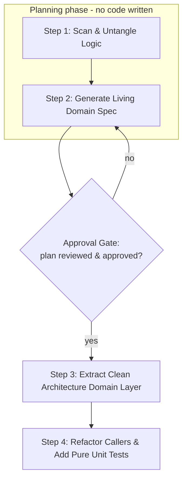

# Kotlin Android Clean Domain Extractor

Use this skill when refactoring Kotlin Android code (e.g., legacy ViewModels, fat Repositories, God classes) to extract pure business logic into a Clean Architecture `domain` layer and document the domain rules for cross-team alignment.

## Core Principles

1. **Zero Android Dependencies in Domain**: The `domain` layer must be 100% pure Kotlin. Never import `android.*`, `androidx.*`, `Context`, `Lifecycle`, `Bundle`, or UI elements.
2. **Single Responsibility Use Cases**: Each business action is encapsulated in a dedicated `UseCase` / `Interactor` (e.g., `CalculateCartDiscountUseCase`, `ValidateCheckoutEligibilityUseCase`).
3. **Living Documentation First**: Formulate explicit business rules, invariants, and decision tables in markdown before writing or altering code.
4. **Fast JVM-Only Unit Tests**: Extracted domain logic must be testable via standard JVM unit tests without Robolectric or Android instrumentation.
5. **Plan Before Code**: Steps 1–2 are a planning phase. Finish the classification and the domain spec, present the extraction plan, and get explicit approval **before** creating or editing any `.kt` file. Never jump straight to code.

---

## When to Skip a Layer

Clean Architecture adds boilerplate. For small or prototype apps, a repository + ViewModel is enough. Add use cases when:

- Multiple ViewModels share the same business logic
- Business rules involve more than one data source
- You need to test logic independently of framework code

Do not cargo-cult layers. Add them when the complexity justifies the structure.

---

## 4-Step Execution Workflow

Steps 1–2 are **planning only**. The single artifact they may write is the domain spec markdown — no `.kt` file is created, moved, or edited until the Approval Gate passes.

### Step 1: Scan & Untangle Logic
1. Inspect the target Kotlin file (e.g. `CartViewModel.kt`, `PaymentManager.kt`).
2. Classify code elements into three layers:
   - **Domain (Target for extraction)**: Pricing algorithms, discounts, eligibility checks, validation rules, state machine transitions, domain error decisions.
   - **Presentation**: `ViewModel`, `StateFlow`, `LiveData`, UI state, UI event handling, Jetpack Compose / View binding, navigation events.
   - **Data & Infrastructure**: Room DAOs, Retrofit API calls, DataStore/SharedPreferences, Network status, Android `Context`.
3. Refer to [references/android_clean_arch_rules.md](./references/android_clean_arch_rules.md) for boundary heuristics.
4. Apply the **When to Skip a Layer** test above. If none of its conditions hold, stop here and keep the logic in the repository/ViewModel — say so instead of extracting.

### Step 2: Generate Living Domain Spec (Cross-Team Sharing)
1. Before modifying code, generate a business specification file at `docs/domain/<feature_name>.md`.
2. Follow [references/domain_doc_template.md](./references/domain_doc_template.md) to document:
   - **Ubiquitous Language**: Definitions of terms used by developers, QA, and product teams.
   - **Business Rules Matrix / Decision Table**: Exact inputs, constraints, and outputs.
   - **State Transition Diagram**: Mermaid state diagram of domain entities.
   - **Domain Invariants**: Conditions that must always hold true.

### Approval Gate (end of planning phase)

Stop here. Present a short extraction plan and wait for an explicit go-ahead:

1. **Skip-layer verdict**: which condition from **When to Skip a Layer** is met, or the recommendation not to extract at all.
2. **Use case list**: each proposed `UseCase` with its one-sentence responsibility.
3. **File plan**: files to create, files to modify, files that become dead code.
4. **Open questions**: ambiguous business rules that need a product/QA answer before they can be encoded.

If the reviewer changes a rule or trims the scope, update the domain spec and re-present — do not carry an unapproved assumption into code.

### Step 3: Extract Clean Architecture Domain Layer
Create the pure domain components under `domain/`:
1. **Domain Models & Value Objects**: Pure Kotlin data classes (e.g. `CartItem`, `Money`, `DiscountPolicy`).
2. **Domain Result & Error Types**: Sealed interfaces/classes representing outcomes (e.g. `CheckoutFailure`).
3. **Repository Interfaces**: Domain gateways without framework types (e.g. `interface CartRepository`).
4. **UseCases (Interactors)**: Single-purpose classes using `operator fun invoke(...)`.
   - See [references/usecase_patterns.md](./references/usecase_patterns.md) for standard use case conventions.

### Step 4: Refactor Callers & Add Pure Unit Tests
1. **Refactor the Caller**: Update the `ViewModel` or caller to inject the new `UseCase`(s) via Hilt/Koin and delegate domain decisions.
2. **Create Mappers**: In the `data` layer, implement mappers (`Entity.toDomain()`, `Domain.toDto()`) to isolate external contracts.
3. **Write JVM Unit Tests**: Create unit tests for the extracted `UseCase` and domain models testing all decision table branches.
4. Verify all tests pass with `./gradlew testDebugUnitTest`.
