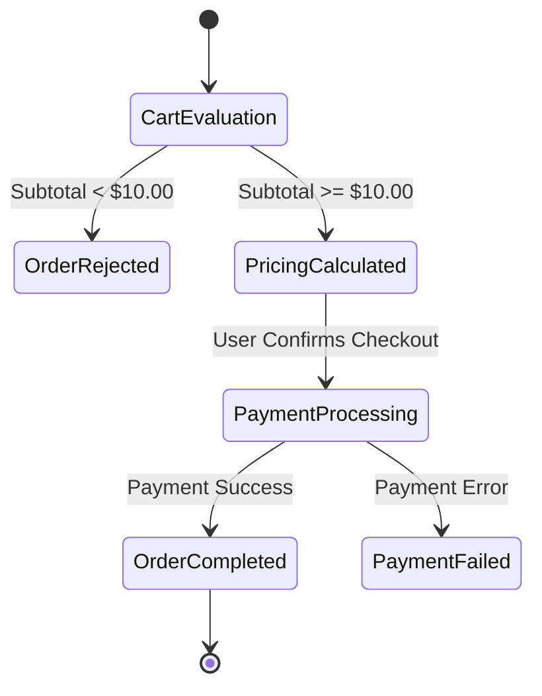

# Domain Specification: Checkout Pricing & Discount Rules

## 1. Overview & Context
This domain specification governs cart calculations, loyalty discounts, and coupon applications during checkout. It serves as the single source of truth for Engineering, QA, and Product.

---

## 2. Ubiquitous Language (Glossary)

| Term | Business Definition | Kotlin Clean Architecture Type |
| :--- | :--- | :--- |
| **Cart Item** | A single merchandise unit and selected quantity | `data class CartItem` |
| **Subtotal** | The sum of raw item totals before discounts or taxes | `val subtotal: Double` |
| **VIP Member** | A verified customer entitled to tier-based discounts | `isVipUser: Boolean` |
| **Minimum Threshold**| Minimum order value required to proceed ($10.00) | `MINIMUM_ORDER_THRESHOLD` |

---

## 3. Business Invariants & Rules

1. **Rule-PRC-01 (Minimum Order Constraint)**: An order cannot be placed if the raw subtotal is below \$10.00.
2. **Rule-PRC-02 (VIP Benefit)**: Active VIP customers receive a 15% discount on the raw subtotal.
3. **Rule-PRC-03 (Coupon Stacking)**: Fixed-amount promotional coupons stack on top of VIP discounts.
4. **Rule-PRC-04 (Non-Negative Total)**: The total charge amount after discounts can never be negative (floor at \$0.00).

---

## 4. Decision Matrix / Business Rules Table

| Scenario ID | Subtotal | VIP Status | Coupon Code | Applied Discount | Final Total | Status |
| :--- | :--- | :--- | :--- | :--- | :--- | :--- |
| **SC-01** | \$8.00 | Any | Any | \$0.00 | N/A | ❌ Rejected (`MinimumOrderNotMet`) |
| **SC-02** | \$100.00 | Standard (False)| None | \$0.00 | \$100.00 | ✅ Approved |
| **SC-03** | \$100.00 | VIP (True) | None | \$15.00 (15%) | \$85.00 | ✅ Approved |
| **SC-04** | \$100.00 | VIP (True) | `SUMMER2026` | \$20.00 (\$15 + \$5) | \$80.00 | ✅ Approved |
| **SC-05** | \$10.00 | VIP (True) | `SUMMER2026` | \$6.50 (\$1.5 + \$5) | \$3.50 | ✅ Approved |

---

## 5. State Transition Flow

---

## 6. Domain Error Catalog

| Domain Error | Trigger Condition | Presentation UI Guidance |
| :--- | :--- | :--- |
| `CheckoutError.MinimumOrderNotMet` | Cart subtotal < \$10.00 | Display banner: "Minimum order is $10.00. Add $X more to checkout." |
| `CheckoutError.EmptyCart` | Zero items in cart | Disable checkout button and prompt to browse products. |
