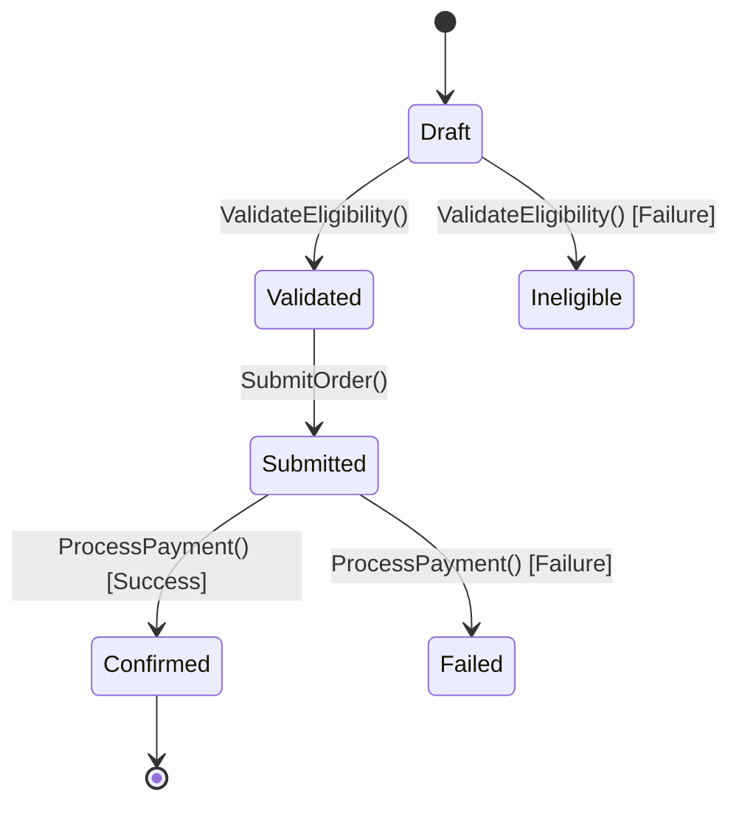

# Living Domain Specification Template

Use this markdown structure to document extracted business rules in `docs/domain/<feature_name>.md`.

---

```markdown
# Domain Specification: [Feature Name]

## 1. Overview & Context
Brief summary of the business capability, purpose, and stakeholders.

## 2. Ubiquitous Language (Glossary)
Define key domain terms shared between Product, Engineering, and QA.

| Term | Business Definition | Code Representation |
| :--- | :--- | :--- |
| **[Term 1]** | [Plain-English business definition] | `DomainEntity / ValueObject` |
| **[Term 2]** | [Plain-English business definition] | `SealedClass / Enum` |

## 3. Business Invariants & Rules
Uncompromising rules that must always hold true in the system.
1. **[Rule Name 1]**: [Explanation of condition that must never be violated]
2. **[Rule Name 2]**: [Explanation of calculation or threshold]

## 4. Decision Matrix / Business Rules Table
Tabular breakdown of inputs, conditions, and expected outcomes.

| Scenario / Case | Condition A | Condition B | Expected Result | Domain Error / Output |
| :--- | :--- | :--- | :--- | :--- |
| Standard Case | e.g. Valid coupon | Total >= $50 | 10% discount applied | `DiscountResult.Applied` |
| Expired Coupon | e.g. Expired date | Any | No discount | `DiscountError.Expired` |
| Min Amount Not Met| e.g. Valid coupon | Total < $50 | No discount | `DiscountError.ThresholdNotMet` |

## 5. State Transition Flow
Visual diagram of valid state changes.



## 6. Domain Error Catalog
Exhaustive list of domain failures and their business meaning.

| Error Code / Type | Trigger Condition | Presentation Guidance |
| :--- | :--- | :--- |
| `OrderError.InsufficientStock` | Requested qty > available stock | Show out-of-stock badge with available qty |
| `OrderError.PaymentDeclined` | Gateway declined payment | Prompt user to retry or update card |

## 7. Relevant Code Artifacts
- **Use Cases**: [`CalculateDiscountUseCase`](file:///path/to/CalculateDiscountUseCase.kt)
- **Domain Models**: [`Cart`](file:///path/to/Cart.kt), [`DiscountPolicy`](file:///path/to/DiscountPolicy.kt)
- **Unit Tests**: [`CalculateDiscountUseCaseTest`](file:///path/to/CalculateDiscountUseCaseTest.kt)
```
