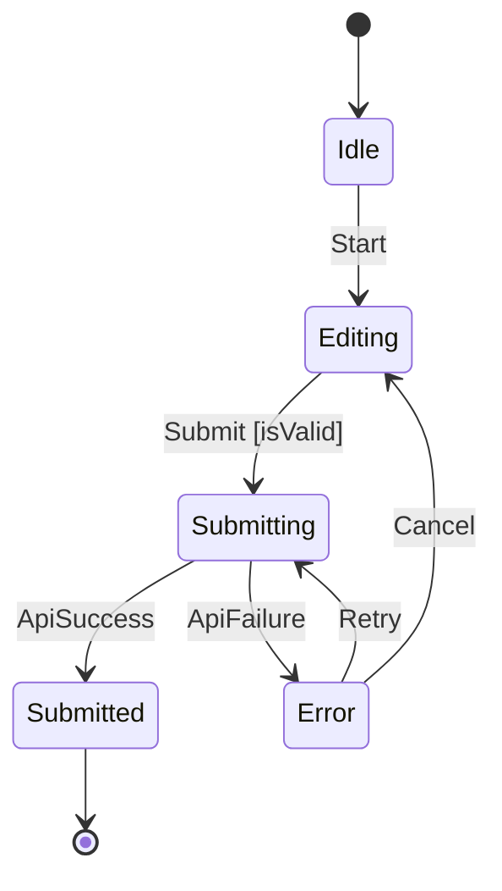

# Statechart — <Feature / Ticket Name>

> **Skip Check:** Required because `<e.g. >= 4 states / async concurrency / process death invariant>`.
> *(If trivial CRUD or Fast-track bugfix, replace this entire section with `Statechart: SKIPPED (<reason>)`.)*

| State | Event / Intent | Guard | Next State | Effect / Event |
|---|---|---|---|---|
| `Idle` | `Start` | `—` | `Editing` | `loadInitialDraft()` |
| `Editing` | `Submit` | `isValid` | `Submitting` | `submitRequest()` |
| `Editing` | `Submit` | `!isValid` | `IGNORE` | `ShowValidationError` |
| `Submitting` | `Submit` | `—` | `IGNORE` | `—` |
| `Submitting` | `ApiSuccess` | `—` | `Submitted` | `NavigateToSuccess` |
| `Submitting` | `ApiFailure` | `—` | `Error` | `ShowRetrySnackbar` |
| `Error` | `Retry` | `—` | `Submitting` | `submitRequest()` |
| `Error` | `Cancel` | `—` | `Editing` | `clearError()` |
| `Idle` | `ApiSuccess` | `—` | `DROP` | `—` |
| `Submitted` | `Done` | `—` | `[*]` | `—` |

**Lifecycle Recovery:** `Process death in [Editing] or [Error] -> restore draft via SavedStateHandle; in [Submitting] -> reset to [Editing] without auto-resubmitting.`
