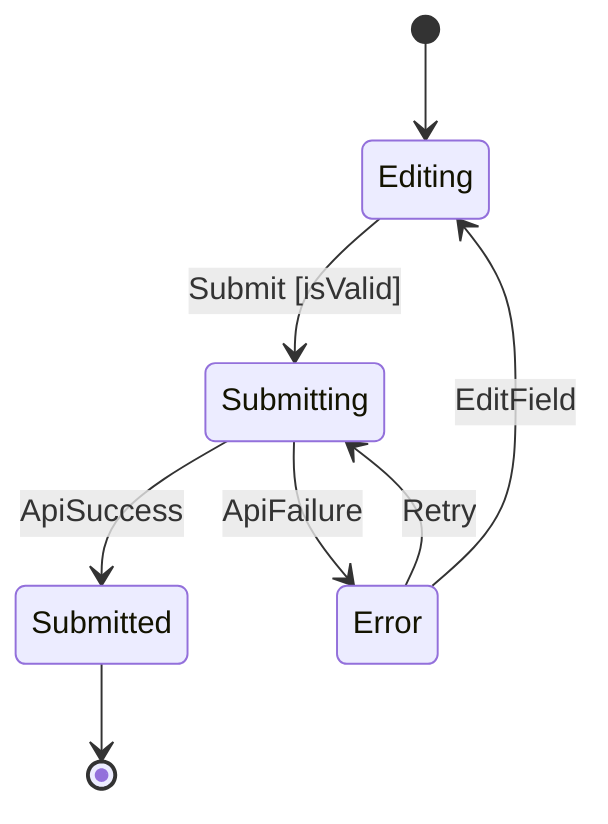
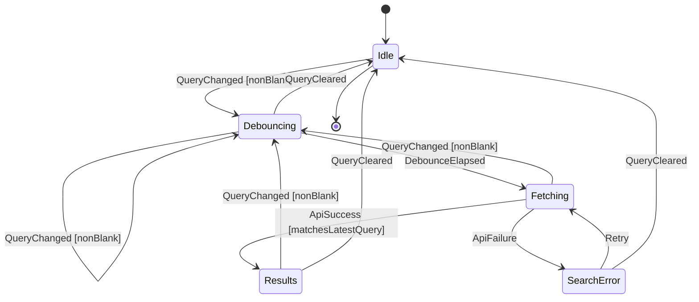
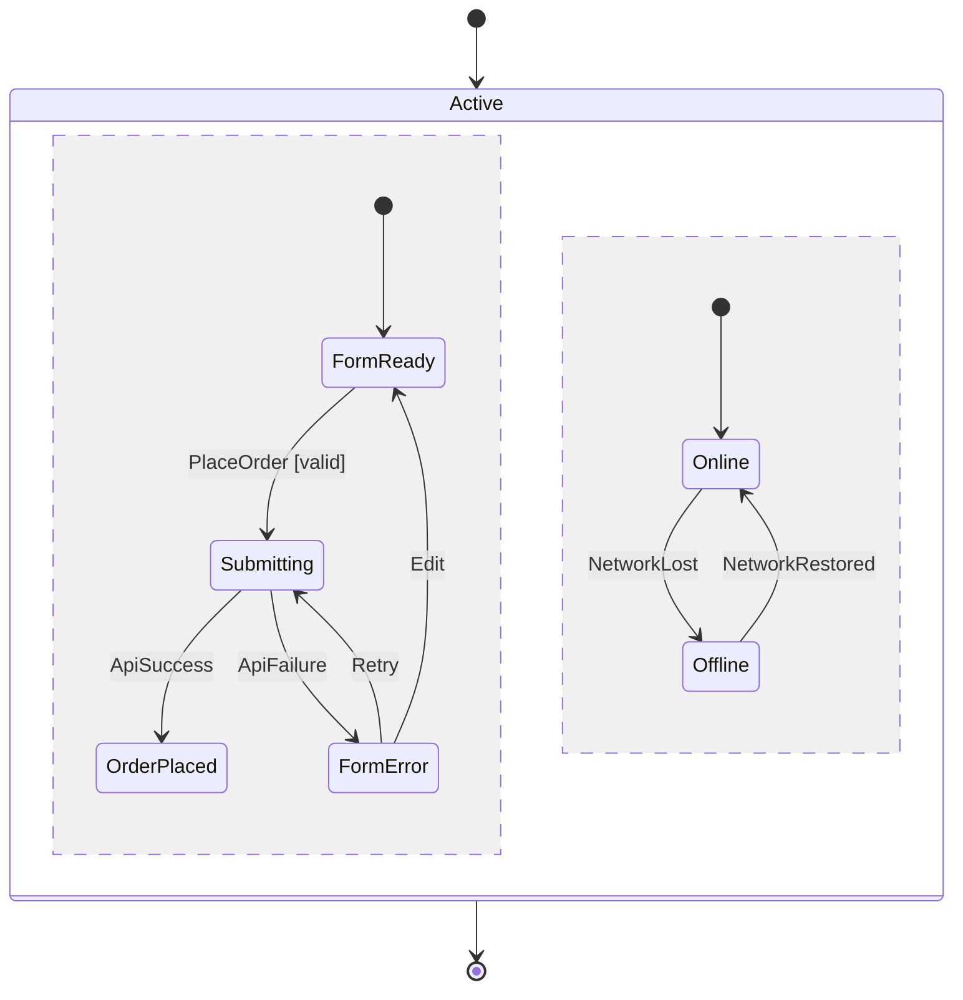

# Android MVI Statechart Patterns

Reference patterns for `/design-state`. Each pattern prevents a classic Android production bug (double-submit, stale callback, flag explosion, or process death state loss).

---

## Pattern 1: Async Submit with Double-Tap & Retry Guard

**Prevents:** Duplicate API mutations on rapid taps; getting stuck in `Submitting` on timeout; losing form input on error.



| State | Event / Intent | Guard | Next State | Effect / Event |
|---|---|---|---|---|
| `Editing` | `Submit` | `isValid` | `Submitting` | `submitOrder()` |
| `Editing` | `Submit` | `!isValid` | `IGNORE` | `ShowValidationErrors` |
| `Submitting` | `Submit` | `—` | `IGNORE` | `—` *(blocks double-tap)* |
| `Submitting` | `ApiSuccess` | `—` | `Submitted` | `NavigateSuccess` |
| `Submitting` | `ApiFailure` | `—` | `Error` | `ShowRetryBanner` |
| `Error` | `Retry` | `—` | `Submitting` | `submitOrder()` |
| `Error` | `EditField` | `—` | `Editing` | `updateDraft()` |

**Lifecycle Recovery:** `Process death in [Editing] or [Error] -> restore draft fields via SavedStateHandle; in [Submitting] -> recover as [Editing] with neutral retry prompt (never auto-resubmit mutation).`

---

## Pattern 2: Debounced Search with Stale Response Drop

**Prevents:** Older slow network response overwriting newer search query results; stale callback firing after user closes search.



| State | Event / Intent | Guard | Next State | Effect / Event |
|---|---|---|---|---|
| `Idle` | `QueryChanged` | `nonBlank` | `Debouncing` | `scheduleDebounce(reqId)` |
| `Debouncing` | `QueryChanged` | `nonBlank` | `Debouncing` | `cancelPrev & scheduleDebounce(reqId)` |
| `Debouncing` | `QueryCleared` | `—` | `Idle` | `cancelDebounce()` |
| `Debouncing` | `DebounceElapsed` | `—` | `Fetching` | `searchApi(query, reqId)` |
| `Fetching` | `QueryChanged` | `nonBlank` | `Debouncing` | `cancelJob & scheduleDebounce(reqId)` |
| `Fetching` | `ApiSuccess` | `matchesLatestQuery` | `Results` | `renderItems()` |
| `Fetching` | `ApiSuccess` | `!matchesLatestQuery` | `DROP` | `—` *(discard stale response)* |
| `Fetching` | `ApiFailure` | `—` | `SearchError` | `showErrorInline()` |
| `Idle` | `ApiSuccess` | `—` | `DROP` | `—` *(user cleared before response)* |
| `Results` | `QueryChanged` | `nonBlank` | `Debouncing` | `scheduleDebounce(reqId)` |
| `Results` | `QueryCleared` | `—` | `Idle` | `clearItems()` |
| `SearchError` | `Retry` | `—` | `Fetching` | `searchApi(query, reqId)` |
| `SearchError` | `QueryCleared` | `—` | `Idle` | `clearError()` |

**Lifecycle Recovery:** `Config change preserves query & results in ViewModel; Process death restores query string via SavedStateHandle and transitions to [Debouncing] if non-blank.`

---

## Pattern 3: Composite State + Orthogonal (Parallel) Regions

**Prevents:** Combinatorial state explosion (e.g., 3 network states × 3 form states = 9 states) in multi-region screens like Checkout.



| State | Event / Intent | Guard | Next State | Effect / Event |
|---|---|---|---|---|
| `FormReady` | `PlaceOrder` | `valid && isOnline` | `Submitting` | `placeOrder()` |
| `FormReady` | `PlaceOrder` | `!isOnline` | `IGNORE` | `ShowOfflineBanner` |
| `Submitting` | `PlaceOrder` | `—` | `IGNORE` | `—` |
| `Submitting` | `ApiSuccess` | `—` | `OrderPlaced` | `NavigateReceipt` |
| `Submitting` | `ApiFailure` | `—` | `FormError` | `ShowErrorSnackbar` |
| `FormError` | `Retry` | `isOnline` | `Submitting` | `placeOrder()` |
| `FormError` | `Edit` | `—` | `FormReady` | `clearError()` |
| `Online` | `NetworkLost` | `—` | `Offline` | `showOfflineIndicator()` |
| `Offline` | `NetworkRestored` | `—` | `Online` | `hideOfflineIndicator()` |
| `OrderPlaced` | `Done` | `—` | `[*]` | `finishFlow()` |

**Lifecycle Recovery:** `Network region re-evaluates ConnectivityManager on foreground resume; Form region restores draft inputs via SavedStateHandle.`

---

## Pattern 4: Kotlin MVI Mapping Reference

How a Transition Table maps 1-to-1 into `ViewModel.handleIntent()` (avoiding boolean flag soup):

```kotlin
// Encode finite states as sealed interface (no impossible boolean combinations)
sealed interface CheckoutPhase {
    data object Editing : CheckoutPhase
    data class Submitting(val requestId: String) : CheckoutPhase
    data class Error(val message: String, val canRetry: Boolean) : CheckoutPhase
    data class Submitted(val orderId: String) : CheckoutPhase
}

fun handleIntent(intent: CheckoutIntent) {
    when (val phase = _uiState.value.phase) {
        CheckoutPhase.Editing -> when (intent) {
            CheckoutIntent.Submit -> {
                if (!isValid()) {
                    emitEvent(CheckoutEvent.ShowValidationErrors)
                    return // IGNORE transition
                }
                startSubmit()
            }
            else -> Unit
        }
        is CheckoutPhase.Submitting -> when (intent) {
            CheckoutIntent.Submit -> return // IGNORE: prevents double-submit
            is CheckoutIntent.ApiSuccess -> {
                if (intent.requestId != phase.requestId) return // DROP: stale callback
                _uiState.update { it.copy(phase = CheckoutPhase.Submitted(intent.orderId)) }
            }
            is CheckoutIntent.ApiFailure -> {
                if (intent.requestId != phase.requestId) return // DROP: stale callback
                _uiState.update { it.copy(phase = CheckoutPhase.Error(intent.msg, canRetry = true)) }
            }
            else -> Unit
        }
        is CheckoutPhase.Error -> when (intent) {
            CheckoutIntent.Retry -> startSubmit()
            is CheckoutIntent.EditField -> _uiState.update { it.copy(phase = CheckoutPhase.Editing) }
            else -> Unit
        }
        is CheckoutPhase.Submitted -> Unit
    }
}
```
