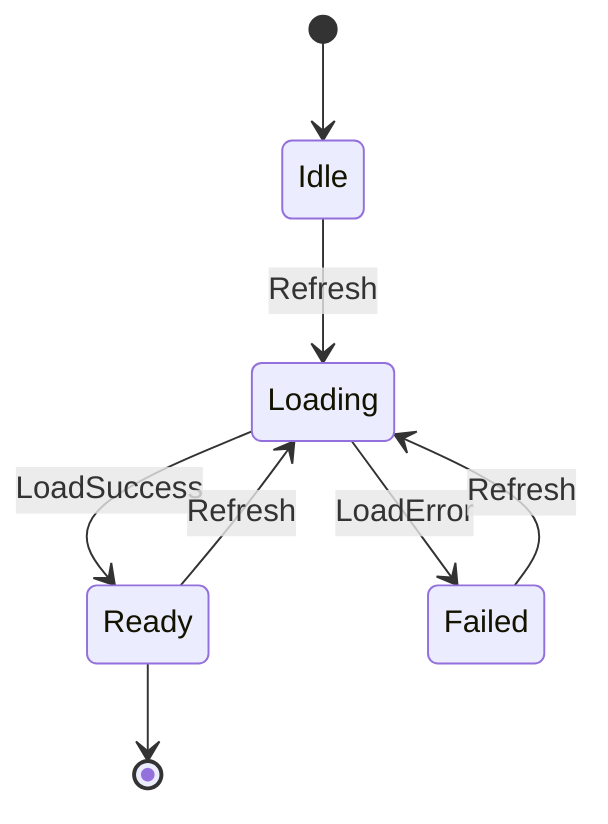

# Technical Contract — <EPIC NAME>

> STATUS: 🔓 DRAFT | 🔒 FROZEN — pick one honestly. Frozen means every amendment
> needs sign-off; if amendments land without it, this is a draft.
> Every change bumps the version and gets a row in the amendment log.

- **Epic / PRD:** <link, pinned version + commit>
- **Platform / architecture:** <Android MVI (handleIntent) + Clean | iOS MVVM | ...>
- **Version:** 1.0.0  ·  **Owner:** <name>  ·  **Status since:** <date>
- **Consumed by slices:** <Slice A>, <Slice B>, ...

> Cite sections by number (`§1.1`) from slices, steps and questions.

## §1 Shared Data Models

> Only fields EVERY listed slice needs now. Story-private fields do NOT go here.
> Encode rules in types (sealed/enum) so the compiler enforces them.
> Fields the backend doesn't send yet: include them, with an UNKNOWN/safe value.

```kotlin
// or Swift
data class <Model>(
    // field: Type   // note why shared
)
```

## §2 Shared Interfaces (signatures only — no implementation)

```kotlin
interface <Repository/UseCase> {
    // fun ...(): ReturnType
}
```

## §3 Shared Statechart & MVI Contract (UI State / Intent / Event / Navigation)

> Android MVI, `handleIntent` style — see the repo's workflow §1a. One data-class state;
> finite parts are sealed/enum fields; one-time output is `Event` via `SharedFlow`.
> **Statechart Rule (`/design-state`):** Required if `>= 4` finite states, nested/parallel regions,
> async concurrency (debounce/polling/double-submit), or process-death recovery. Otherwise write `Statechart: SKIPPED (<reason>)`.



| State | Event / Intent | Guard | Next State | Effect / Event |
|---|---|---|---|---|
| `Idle` | `Refresh` | `—` | `Loading` | `fetchData()` |
| `Loading` | `Refresh` | `—` | `IGNORE` | `—` |
| `Loading` | `LoadSuccess` | `—` | `Ready` | `renderData()` |
| `Loading` | `LoadError` | `—` | `Failed` | `ShowError` |
| `Failed` | `Refresh` | `—` | `Loading` | `fetchData()` |
| `Ready` | `Refresh` | `—` | `Loading` | `fetchData()` |
| `Idle` | `LoadSuccess` | `—` | `DROP` | `—` |
| `Ready` | `Close` | `—` | `[*]` | `—` |

**Lifecycle Recovery:** `Config change preserves UiState in ViewModel; Process death in [Loading] resets to [Idle] and re-triggers Refresh if required.`

```kotlin
data class <Feature>UiState(
    val data: <Model>? = null,
    val load: LoadState = LoadState.Idle,   // enum/sealed field for finite states
)

sealed class <Feature>Intent {
    data object Refresh : <Feature>Intent()
}

sealed class <Feature>Event {
    data class ShowError(val message: String) : <Feature>Event()
}
// ViewModel entry point: fun handleIntent(intent: <Feature>Intent)
```

## Not shared (resists Contract creep — not a deferral list)

- <field/behavior a single slice wanted — kept inside that slice, not shared>

## Amendment log

| Version | Date | Change | Approved by |
|---------|------|--------|-------------|
| 1.0.0   | <date> | Initial | <team> |
