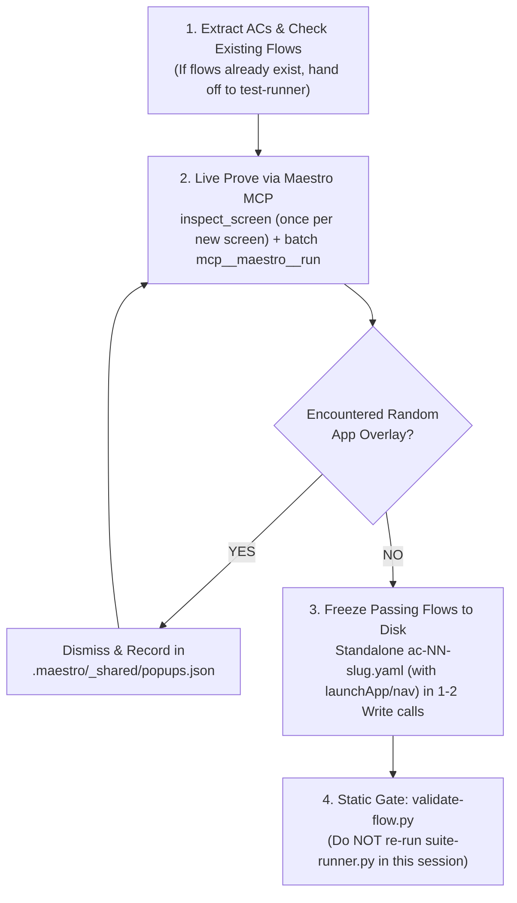

# Test Author — Prove-First, Freeze-After Maestro Authoring

A dedicated skill for verifying acceptance criteria (ACs) on the first pass with **minimum LLM calls** and freezing deterministic `.yaml` flows for later regression.

> [!IMPORTANT]
> **Separation of Concerns (Prove-First → Freeze-After):**
> - **Authoring (`/test-author` — First Pass / New ACs):** Uses Maestro MCP (`inspect_screen` + `run`) to prove each AC live on the warm device, records any random app overlays into `.maestro/_shared/popups.json`, and **freezes** the passing YAML steps to disk at the end of the session (`validate-flow.py`).
> - **Executing (`/test-runner` — Re-run / Regression / Gate 3):** Runs already-frozen suites via `suite-runner.py` in a fresh session with near-zero token cost. **Never** re-run `suite-runner.py` inside the same `/test-author` session if the ACs just passed via MCP.

---

## 1. Directory & File Organization Standards

All test flows live under `.maestro/<EPIC>/`.

```
.maestro/<EPIC>/
├── _shared/                           # Reusable setup/teardown helpers (must start with '_')
│   ├── _login-user.yaml
│   └── _seed-order.yaml
├── 01-order-list/                     # NN-<domain-slug> (semantic, human-readable)
│   ├── ac-01-display-all-orders.yaml  # ac-NN-<slug>.yaml (mapped 1:1 to acceptance criteria)
│   ├── ac-02-pull-to-refresh.yaml
│   └── ac-03-filter-by-status.yaml
├── 02-order-details/
│   ├── ac-01-view-order-spec.yaml
│   └── ac-02-item-rows-layout.yaml
└── 03-checkout-payment/
    ├── ac-01-submit-disabled-initially.yaml
    └── ac-02-apply-discount-code.yaml
```

### Strict Naming Rules
1. **Directories:** Must match `^\d{2}-[a-z0-9-]+$` (e.g. `01-order-list`).
   - ❌ Never use cryptic abbreviations (`s1`, `f3`, `s2s4`).
2. **Test Flow Files:** Must match `^ac-\d{2}-[a-z0-9-]+\.yaml$` (e.g. `ac-01-display-all-orders.yaml`).
   - ❌ Never use ambiguous names (`r-1.yaml`, `test.yaml`, `step1.yaml`).
3. **Helper Flows:** Must start with `_` (e.g. `_login.yaml`, `_cleanup.yaml`).
   - Helper flows are excluded from regression runners automatically.

---

## 2. Authoring Workflow (Prove-First, Freeze-After)

Blindly writing YAML flows from source code before touching the device causes selector mismatches and expensive `suite-runner.py` retry loops. Instead, prove each AC live first, then freeze the working YAML once:



### Step 1: Extract Acceptance Criteria & Check Preconditions
1. Extract criteria from the story, PRD, or plan file:
   ```bash
   skills/test-author/scripts/extract-acceptance.sh plans/<EPIC_OR_TICKET>/PLAN.md [step-id]
   # or for bug workflows:
   skills/test-author/scripts/extract-acceptance.sh plans/<TICKET>/flow-bug.md
   ```
2. Verify device connectivity via `mcp__maestro__list_devices` (pass explicit `device_id` if ≥2 devices exist).
3. If flows for these ACs **already exist** on disk, stop authoring and run them via `suite-runner.py` instead.

### Step 2: Live Prove-First via Maestro MCP (Low-Call Budget)
Run ACs sequentially on the live warm device using `mcp__maestro__inspect_screen` and `mcp__maestro__run`. Every model call re-reads the full conversation context, so **call count is the primary cost driver**:
* **Never run `adb shell uiautomator dump` during a Maestro session:** Maestro holds Android's `UiAutomation` accessibility service, so `uiautomator dump` reliably fails and wastes turns. Always use `mcp__maestro__inspect_screen` to inspect the live screen.
* **Screen Inspection Limit:** Call `inspect_screen` **at most once per newly visited screen** to get runtime `id` / `text` selectors. Only grep source code (`extract-selectors.py` / `Grep`) when a view lacks a runtime ID or you need exact `strings.xml` error copy.
* **Batch Steps per AC:** Put an entire AC's interaction + assertion sequence (e.g., open sheet → select option → confirm → assert) into **one `mcp__maestro__run` call** instead of tapping step-by-step.
* **Fix In-Place:** If a selector or step fails, inspect once, adjust the YAML snippet, and re-run that single snippet immediately (~2–5s).
* **Random Overlays / Popups:** If an unexpected app overlay (user guide, promo, rating, tooltip) appears during MCP testing, dismiss it to continue AND append a safe rule (`when_visible` + `actions`) to `.maestro/_shared/popups.json` (see `skills/test-author/templates/popups.json`). Never use overly broad selectors like `OK` or `.*close.*`.

### Step 3: Freeze Passing Flows to Disk (Batch Write)
Once all ACs have passed live, freeze the exact working YAML snippets into `.maestro/<EPIC>/<NN-domain>/ac-NN-<slug>.yaml` in **batched/parallel `Write` calls** and run `validate-flow.py` once:
* **Standalone Precondition Rule (Mandatory):** Because MCP ran on a warm state, every frozen `ac-NN-*.yaml` **MUST** be standalone from app launch or a shared `_nav/` subflow (`launchApp: { clearState: false }` + navigation steps proved in AC-01) so `suite-runner.py` can execute any flow independently later.
* **Self-Contained Flags / Environment State:** Never leave frozen flows dependent on manual pre-toggled device state (feature flags, experiment variants, mock switches). Put project-specific setup/teardown helpers in `.maestro/_shared/` (e.g., `_enable-flag.yaml` / `_reset-flag.yaml`) and invoke them from the flow. Note that `launchApp.arguments` / intent extras can behave inconsistently across Android API levels (e.g., API 33 vs API 36, or when an app persists a dev setting on launch #1 and only applies it on cold start #2) — prefer whatever launch/flag mechanism is proven on the target device.
* **Keep Helpers Minimal:** Only extract `.maestro/<EPIC>/_shared/` or `.maestro/_nav/` helpers when ≥2 flows share the exact same setup/navigation sequence.
* **Verify & Report Concisely:** Never report ACs as frozen until all `.yaml` files are written and validated; keep the final summary brief (table/bullets).

### Step 4: Static Validation (End of Authoring Session)
Always run the static validator before finishing:
```bash
python3 skills/test-author/scripts/validate-flow.py .maestro/<EPIC>/
```
The validator checks:
* Directory (`NN-<domain-slug>`) and file (`ac-NN-<slug>.yaml`) naming
* Coordinate tap prohibition (`point:`)
* Presence of assertions (`assertVisible`, `assertTrue`, `assertNotVisible`)
* Standalone precondition (`launchApp` / `runFlow`)
* `.maestro/_shared/popups.json` rule safety (no overly broad selectors)

---

## 3. When to Run `suite-runner.py`
* **DO NOT** run `suite-runner.py` at the end of `/test-author` if all ACs just passed in the live MCP session — the flows are now proven and frozen.
* **DO** run `suite-runner.py` in a **new session** for regression, post-fix verification, or Gate 3 before creating an MR:
  ```bash
  python3 skills/test-runner/scripts/suite-runner.py .maestro/<EPIC>/ -m step
  ```
