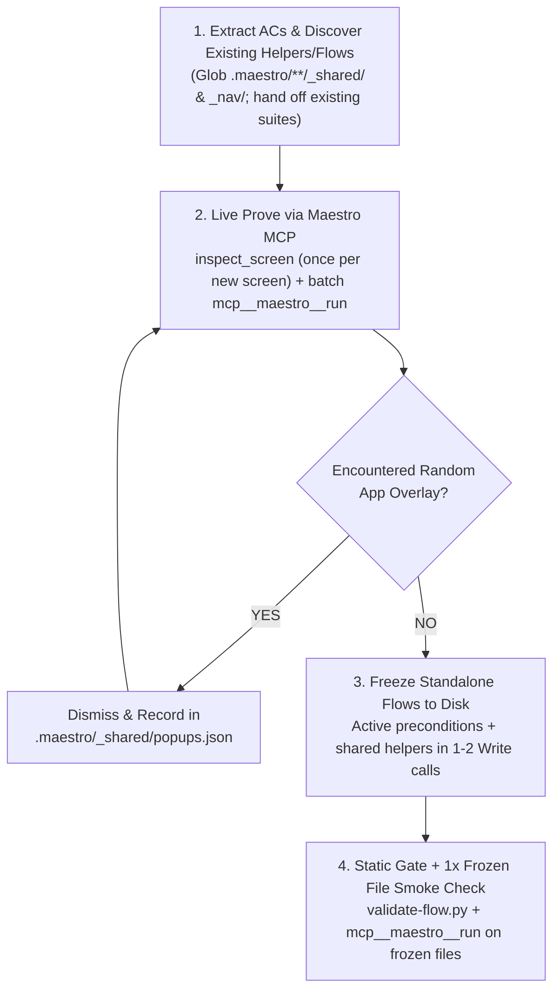

# Test Author — Prove-First, Freeze-After Maestro Authoring

A dedicated skill for verifying acceptance criteria (ACs) on the first pass with **minimum LLM calls** and freezing deterministic `.yaml` flows for later regression.

> [!IMPORTANT]
> **Separation of Concerns (Prove-First → Freeze-After):**
> - **Authoring (`/test-author` — First Pass / New ACs):** Uses Maestro MCP (`inspect_screen` + `run`) to prove each AC live on the warm device, records any random app overlays into `.maestro/_shared/popups.json`, and **freezes** the passing YAML steps to disk at the end of the session (`validate-flow.py`).
> - **Executing (`/test-runner` — Re-run / Regression / Gate 3):** Runs already-frozen suites via `suite-runner.py` in a fresh session at flat orchestration cost (independent of AC count). **Never** re-run `suite-runner.py` inside the same `/test-author` session if the ACs just passed via MCP.

---

## 1. Directory & File Organization Standards

All test flows live under `.maestro/<EPIC>/`.

```
.maestro/
├── _shared/                           # Cross-ticket reusable helpers (_nav-*, _setup-*, _reset-*)
│   └── popups.json                    # Project overlay/dialog dismissal rules
└── <EPIC>/
    ├── _shared/                       # Ticket-only helpers (reuse root _shared/ first)
    │   ├── _setup-order-state.yaml
    │   └── _reset-order-state.yaml
    ├── 01-order-list/                 # NN-<domain-slug> (semantic, human-readable)
    │   ├── ac-01-display-all-orders.yaml  # ac-NN-<slug>.yaml (mapped 1:1 to ACs)
    │   ├── ac-02-pull-to-refresh.yaml
    │   └── ac-03-filter-by-status.yaml
    ├── 02-order-details/
    │   ├── ac-01-view-order-spec.yaml
    │   └── ac-02-item-rows-layout.yaml
    └── 03-checkout-payment/
        ├── ac-01-submit-disabled-initially.yaml
        └── ac-02-apply-discount-code.yaml
```

### Strict Naming Rules
1. **Directories:** Must match `^\d{2}-[a-z0-9-]+$` (e.g. `01-order-list`).
   - ❌ Never use cryptic abbreviations (`s1`, `f3`, `s2s4`).
2. **Test Flow Files:** Must match `^ac-\d{2}-[a-z0-9-]+\.yaml$` (e.g. `ac-01-display-all-orders.yaml`).
   - ❌ Never use ambiguous names (`r-1.yaml`, `test.yaml`, `step1.yaml`).
3. **Helper Flows:** Must start with `_` and follow verb-noun naming so runs never reinvent synonyms:
   - `_nav-<screen>.yaml` (navigate to target screen)
   - `_setup-<state>.yaml` (actively establish required initial state/flags)
   - `_reset-<state>.yaml` (teardown / restore state)
   - Helper flows are excluded from regression runners automatically.

---

## 2. Authoring Workflow (Prove-First, Freeze-After)

Blindly writing YAML flows from source code before touching the device causes selector mismatches and expensive `suite-runner.py` retry loops. Instead, prove each AC live first, then freeze the working YAML once:



### Step 1: Extract Acceptance Criteria & Check Preconditions
1. Extract criteria from the story, PRD, or plan file:
   ```bash
   skills/test-author/scripts/extract-acceptance.sh plans/<EPIC_OR_TICKET>/PLAN.md [step-id]
   # or for bug workflows:
   skills/test-author/scripts/extract-acceptance.sh plans/<TICKET>/flow-bug.md
   ```
2. **Precondition Inventory (3 Layers):** Before touching the device, classify each AC's requirements:
   - *UI state:* target screen, tab, filter, sort, toggle, or open dialog/sheet to normalize inside the flow.
   - *Seeded data / account fixture:* assume pre-seeded QA data by default — Maestro verifies UI, it does not fabricate backend fixtures. If required data/role is missing on the device, document `# Account Requirement:` and stop with `BLOCKED` (unless the user explicitly supplied `${TEST_*}` credentials or asked to create data via a `_setup-*` helper).
   - *Mutated persisted state:* if an AC alters persisted filters/toggles/items, plan an `onFlowComplete` `_reset-*` helper or idempotent setup in subsequent flows.
3. **Discover Existing Helpers & Cross-Ticket Flows:**
   - Run `python3 skills/test-author/scripts/yaml_index.py --query "<feature or AC keywords>"` (or `--feature <slug>`) to check `.maestro/` + optional `.maestro/feature-map.json` for already-frozen YAML flows, `nav` helpers, and feature `instruction`s across all tickets.
   - Glob `.maestro/**/_shared/` and `.maestro/_nav/` to reuse existing `_nav-*`, `_setup-*`, and `_reset-*` helpers instead of authoring duplicates.
   - **3-Tier Reuse Rule:** If an existing flow matches the AC verbatim → run via `suite-runner.py` instead of authoring. If it partially matches (same screen/entry, new branch) → clone its setup/selectors into the new `ac-*.yaml` and only use MCP for the new steps (**never** overwrite an existing happy-path flow to turn it into a bug repro).
4. Verify device connectivity via `mcp__maestro__list_devices` (pass explicit `device_id` if ≥2 devices exist).

### Step 2: Live Prove-First via Maestro MCP (Low-Call Budget)
Run ACs sequentially on the live warm device using `mcp__maestro__inspect_screen` and `mcp__maestro__run`. Every model call re-reads the full conversation context, so **call count is the primary cost driver**:
* **Never run `adb shell uiautomator dump` during a Maestro session:** Maestro holds Android's `UiAutomation` accessibility service, so `uiautomator dump` reliably fails and wastes turns. Always use `mcp__maestro__inspect_screen` to inspect the live screen.
* **Screen Inspection Limit:** Call `inspect_screen` **at most once per newly visited screen** to get runtime `id` / `text` selectors. Only grep source code (`extract-selectors.py` / `Grep`) when a view lacks a runtime ID or you need exact `strings.xml` error copy.
* **Batch Steps per AC:** Put an entire AC's interaction + assertion sequence (e.g., open sheet → select option → confirm → assert) into **one `mcp__maestro__run` call** instead of tapping step-by-step.
* **Fix In-Place:** If a selector or step fails, inspect once, adjust the YAML snippet, and re-run that single snippet immediately (~2–5s).
* **Random Overlays / Popups:** If an unexpected app overlay (user guide, promo, rating, tooltip) appears during MCP testing, dismiss it to continue AND append a safe rule (`when_visible` + `actions`) to `.maestro/_shared/popups.json` (see `skills/test-author/templates/popups.json`). Never use overly broad selectors like `OK` or `.*close.*`.

### Step 3: Freeze Passing Flows to Disk (Batch Write)
Once all ACs have passed live, freeze the exact working YAML snippets into `.maestro/<EPIC>/<NN-domain>/ac-NN-<slug>.yaml` (include `# Feature: <domain-slug>` header when known) in **batched/parallel `Write` calls**:
* **Active Standalone Preconditions (Set Idempotently, Never Just Assert):** Because MCP ran on a warm state, every frozen `ac-NN-*.yaml` **MUST** start with `launchApp: { clearState: false, stopApp: true }` (clears backstack/dialogs without logging out) + `_nav-*`/`_setup-*` steps that actively normalize required UI state (explicit tab tap; conditional `runFlow` with `when: { visible / notVisible }` for toggles/filters so already-matching states aren't flipped). **Never** rely on `assertVisible` assuming warm device state, and restore persisted changes via `onFlowComplete` (`_reset-*`) when needed.
* **Account & Device Portability (Mandatory):** Never hardcode account-specific runtime data seen via `inspect_screen` (emails, phones, usernames, order IDs, balances, specific item names/counts). Use structural `id` + `index: 0`, `copyTextFrom` + `${maestro.copiedText}`, static `strings.xml` labels, or regex assertions instead; if the user explicitly supplies test credentials, reference `${ENV_VAR}` (never commit plaintext secrets). See [references/maestro-flow.md](references/maestro-flow.md) for copy-ready YAML patterns.
* **Self-Contained Flags / Environment State:** Never leave frozen flows dependent on manual pre-toggled device state (feature flags, experiment variants, mock switches). Put setup/teardown helpers in `.maestro/_shared/` (cross-ticket) or `.maestro/<EPIC>/_shared/` (ticket-only) using `_setup-<state>.yaml` / `_reset-<state>.yaml`. Note that `launchApp.arguments` / intent extras can behave inconsistently across Android API levels (e.g., API 33 vs API 36, or when an app persists a dev setting on launch #1 and only applies it on cold start #2) — prefer whatever launch/flag mechanism is proven on the target device.
* **Reuse Existing Helpers First:** Always reuse discovered `.maestro/**/_shared/` and `.maestro/_nav/` helpers before creating a new one, and only extract a new helper when ≥2 flows share the exact same setup/navigation sequence.
* **Verify & Report Concisely:** Never report ACs as frozen until all `.yaml` files pass both Step 4 checks; keep the final summary brief (table/bullets).

### Step 4: Static Gate + Frozen-File Smoke Check (End of Authoring)
1. **Static Validation:** Run the static validator:
   ```bash
   python3 skills/test-author/scripts/validate-flow.py .maestro/<EPIC>/
   ```
   Checks directory/file naming, coordinate tap prohibition (`point:`), assertions (`assertVisible`/`assertTrue`/`assertNotVisible`), standalone preconditions (`launchApp`/`runFlow`), and `.maestro/_shared/popups.json` rule safety.
2. **1× File-Level Smoke Execution (`mcp__maestro__run`):** Static validation does not verify `runFlow` relative paths, `../_shared/` includes, or `onFlowComplete` hooks. Run the newly frozen `.yaml` files once from disk via **1 batch `mcp__maestro__run`** call (passing file paths) to confirm the frozen files themselves execute cleanly before finishing.

---

## 3. When to Run `suite-runner.py`
* **DO NOT** run `suite-runner.py` at the end of `/test-author` after proving and verifying the frozen files via MCP — use `mcp__maestro__run` for the 1× file check above.
* **DO** run `suite-runner.py` in a **new session** for regression, post-fix verification, or Gate 3 before creating an MR:
  ```bash
  python3 skills/test-runner/scripts/suite-runner.py .maestro/<EPIC>/ -m step
  ```
