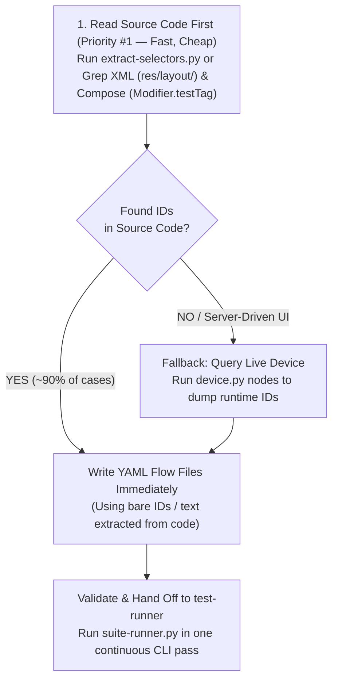

# Test Author — PRD & Acceptance to Deterministic Maestro Flows

A dedicated skill for designing, structuring, and authoring clean, maintainable Maestro E2E test flows with **near-zero device token overhead**.

> [!IMPORTANT]
> **Separation of Concerns:**
> - **Authoring (`/test-author`):** Extracts selectors via **Code-First ID Extraction** (Static Source Code first, Device Fallback only when needed), writes semantic YAML flows, and statically validates them.
> - **Executing (`/test-runner`):** Runs authored suites in one continuous CLI pass via `suite-runner.py`. The runner **NEVER** authors or improvises flows.

---

## 1. Directory & File Organization Standards

All test flows live under `.maestro/<EPIC>/`.

```
.maestro/<EPIC>/
├── _shared/                           # Reusable setup/teardown helpers (must start with '_')
│   ├── _login-user.yaml
│   └── _seed-order.yaml
├── 01-order-list/                     # NN-<domain-slug> (semantic, human-readable)
│   ├── ac-01-display-all-orders.yaml  # ac-NN-<slug>.yaml (mapped 1:1 to acceptance criteria)
│   ├── ac-02-pull-to-refresh.yaml
│   └── ac-03-filter-by-status.yaml
├── 02-order-details/
│   ├── ac-01-view-order-spec.yaml
│   └── ac-02-item-rows-layout.yaml
└── 03-checkout-payment/
    ├── ac-01-submit-disabled-initially.yaml
    └── ac-02-apply-discount-code.yaml
```

### Strict Naming Rules
1. **Directories:** Must match `^\d{2}-[a-z0-9-]+$` (e.g. `01-order-list`).
   - ❌ Never use cryptic abbreviations (`s1`, `f3`, `s2s4`).
2. **Test Flow Files:** Must match `^ac-\d{2}-[a-z0-9-]+\.yaml$` (e.g. `ac-01-display-all-orders.yaml`).
   - ❌ Never use ambiguous names (`r-1.yaml`, `test.yaml`, `step1.yaml`).
3. **Helper Flows:** Must start with `_` (e.g. `_login.yaml`, `_cleanup.yaml`).
   - Helper flows are excluded from regression runners automatically.

---

## 2. Authoring Workflow (Code-First ID Extraction)

Reading source code to extract view IDs is **10× faster** than querying an emulator and costs **~0 device tokens**. Always follow the **Static-First, Dynamic-Fallback** pipeline:



### Step 1: Extract Acceptance Criteria
Extract the criteria from the story, PRD, or plan file:
```bash
skills/test-author/scripts/extract-acceptance.sh plans/<EPIC_OR_TICKET>/PLAN.md [step-id]
# or for bug workflows:
skills/test-author/scripts/extract-acceptance.sh plans/<TICKET>/flow-bug.md
```
Map each top-level acceptance criterion (AC) directly to an `ac-NN-<slug>.yaml` file.

### Step 2: Code-First ID Extraction (Static First, Dynamic Fallback)

#### 2a. Priority #1 — Static Source Code Extraction (~90% of screens)
Before touching the emulator, scan the target feature's XML layouts (`res/layout/`), Jetpack Compose files (`Modifier.testTag`), and `strings.xml` using the static extractor:
```bash
python3 skills/test-author/scripts/extract-selectors.py [feature_module_or_dir] -k "<screen_or_feature_keyword>"
```
*(Or use `Grep` directly on `res/layout/*.xml` for `android:id="@+id/...` and `*.kt` for `testTag`).*

**Selector Rules when extracting from code:**
* **Prefer Bare IDs over flavor-hardcoded package IDs:** When XML defines `android:id="@+id/btn_submit"`, write `id: "btn_submit"` (or regex) so the flow works across all build variants (`dev`, `staging`, `prod`).
* **Jetpack Compose (`Modifier.testTag`):** Use the verbatim string passed to `Modifier.testTag("<tag>")` as `id: "<tag>"` (requires `testTagsAsResourceId = true` on the Compose hierarchy). On a Compose row where the `testTag` sits on the tappable container and the label sits on a child `Text`, `tapOn` by `id:` and `assertVisible` by `text:` (resolved from `strings.xml`).

#### 2b. Priority #2 — Dynamic Device Fallback (Only when static scan misses)
Only query the live device when:
1. `extract-selectors.py` / `Grep` finds no IDs for the target screen, **OR**
2. The screen is **Server-Driven UI (SDUI)**, a **WebView**, or an **external SDK / System Dialog** (e.g., OS permission prompt, third-party picker), **OR**
3. A flow authored from static IDs fails on `suite-runner.py` due to runtime view wrapping (`mergeDescendants`).

When fallback is needed, dump the active screen's compact node table once:
```bash
python3 skills/test-runner/scripts/device.py nodes [optional_substring]
```
*(Never use full `inspect_screen` or full-screen screenshots just to find an ID).*

### Step 3: Establish Common Helpers (`_shared/`)
Check if login, navigation, or data seeding helpers already exist in `.maestro/_nav/` or `.maestro/<EPIC>/_shared/`. If not, author them first.
Helpers must be idempotent:
```yaml
# _login-user.yaml
appId: com.example.app
---
- runFlow:
    when:
      visible:
        id: "btn_login"
    commands:
      - tapOn:
          id: "btn_login"
      # input credentials...
```

### Step 4: Write Test Flows Immediately (Batch Authoring)
Once you have the IDs (from Step 2a or 2b), write the `.yaml` flow files directly to disk without running slow step-by-step interactive MCP loops:
```yaml
# ac-01-display-all-orders.yaml
appId: com.example.app
---
# 1. State Setup / Navigation
- runFlow:
    file: ../_shared/_login-user.yaml
    optional: true

# 2. Action Steps
- extendedWaitUntil:
    visible:
      id: "rv_order_list"
    timeout: 10000

# 3. Assertions (Strictly required)
- assertVisible:
    text: "My Orders"

- assertVisible:
    id: "tv_order_item_title"
```

### ⚠️ Anti-Flakiness & Quality Rules (Mandatory)
* **NO Coordinate Tapping (`point:`):** Never use hardcoded pixel coordinates like `input tap 100 500` or `tapOn: { point: "100, 500" }`. Always extract the view ID from layout XMLs / Compose `testTag` or use accessible text.
* **Always Assert:** Every flow must contain at least one `assertVisible`, `assertTrue`, or `assertNotVisible`. A flow with no assertion is not a test.
* **Timeout Handling:** Prefer `extendedWaitUntil: { visible: ..., timeout: 10000 }` over static `sleep: 5000`.

---

## 3. Static Validation

Before committing or handing off to the runner, always validate the authored flows:

```bash
python3 skills/test-author/scripts/validate-flow.py .maestro/<EPIC>/
```

The validator checks:
* Directory naming standard (`NN-<domain-slug>`)
* File naming standard (`ac-NN-<slug>.yaml`)
* Coordinate tap detection (`point:` prohibition)
* Presence of assertions (`assertVisible`)
* Excessive sleep warnings

---

## 4. Handoff to Test Runner (`suite-runner.py`)

Once static validation passes, hand off the authored flows to `test-runner` to execute in one continuous CLI run:
```bash
python3 skills/test-runner/scripts/suite-runner.py .maestro/<EPIC>/ -m step
```
